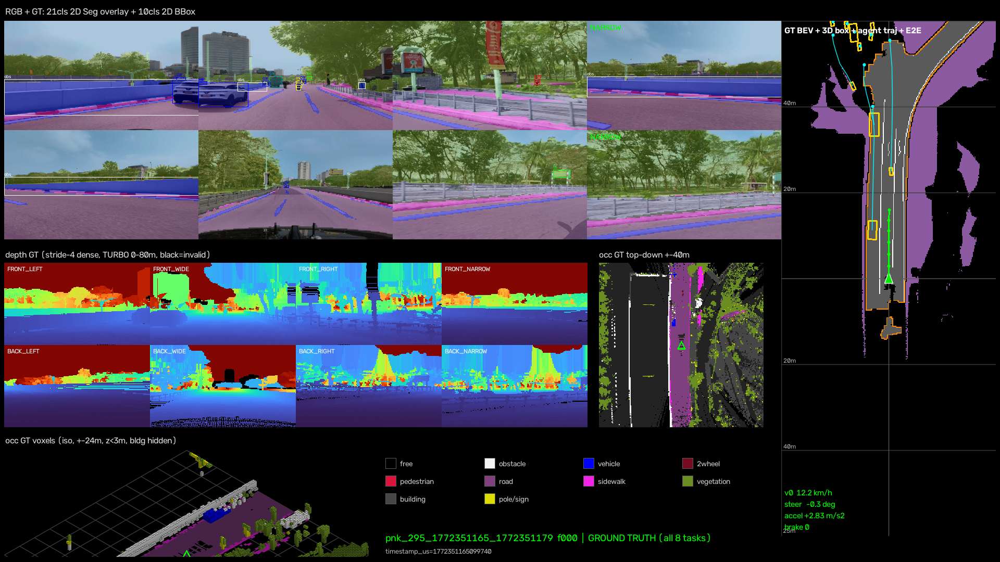
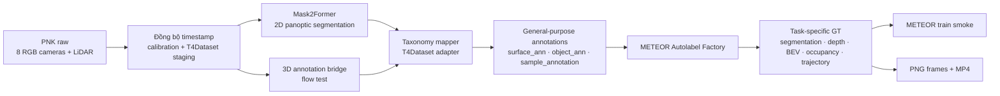

# METEOR — CoMET Replacement Autolabel Pilot

Repo này là fork từ [TIER IV / METEOR](https://github.com/tier4/METEOR). Phần bổ sung trong fork thay upstream CoMET bằng pipeline mã nguồn mở, với mục tiêu kiểm tra thông luồng:

```text
PNK raw data
  → CoMET replacement
  → general-purpose annotations
  → METEOR Autolabel Factory
  → METEOR training smoke test
```

## Kết quả trực quan

[](docs/media/pnk_comet_replacement_demo.mp4)

**[▶ Xem video MP4 đầy đủ — 71 frame, 1920×1080, 5 FPS](docs/media/pnk_comet_replacement_demo.mp4)**

Video được tạo bằng renderer có sẵn của METEOR: mỗi frame tổng hợp camera segmentation, 2D boxes, depth, BEV, occupancy và trajectory thành một ảnh; OpenCV ghép 71 ảnh thành MP4. Không cần web app. Đây là hình trực quan của GT/pseudo-GT sau Autolabel Factory, không phải video prediction từ checkpoint đã train.

## Pipeline autolabel



### Tech stack và vai trò

| Thành phần | Vai trò | Output |
|---|---|---|
| [Mask2Former Swin-L Mapillary Vistas](https://huggingface.co/facebook/mask2former-swin-large-mapillary-vistas-panoptic) | Chạy panoptic segmentation trên từng ảnh camera; tách `stuff` và `thing` | `surface_ann`, `object_ann` |
| PyTorch + Transformers + CUDA | Runtime inference Mask2Former trên GPU | Panoptic masks và class/instance IDs |
| Custom PNK reader, taxonomy mapper và T4Dataset adapter | Đồng bộ camera–LiDAR, đổi calibration, map class và ghi schema METEOR đọc được | T4Dataset scene + general-purpose annotations |
| 3D reference bridge | Dùng 3D boxes có sẵn để kiểm tra trọn luồng schema/factory/train | `sample_annotation` |
| METEOR Autolabel Factory | Chuyển general-purpose annotations thành supervision cho các task | `seg2d21`, depth, BEV, occupancy, boxes, trajectory |
| OpenCV renderer | Ghép các panel đầu ra thành PNG và mã hóa chuỗi frame thành MP4 | Video demo phía trên |
| METEOR `v3s` | Kiểm tra dataset do pipeline sinh có thể đi vào trainer | Checkpoint sau một optimizer step |

> **Segmentation là bắt buộc trong flow test này.** Pipeline kiểm tra đủ `568/568` camera views ở cả annotation T4Dataset và output `seg2d21` của METEOR Factory; thiếu segmentation thì runner dừng.

## Dữ liệu đã chạy

- Raw folder: `D:\mentor_data\PNKData\20260301_1443_VF6_01_1772350996_1772351781`
- Phạm vi: 71 LiDAR keyframes × 8 pinhole cameras = 568 ảnh; bỏ qua 4 fisheye cameras.
- Mask2Former: 9,147 panoptic annotations, gồm 4,512 `surface_ann` và 4,635 `object_ann`.
- 3D flow bridge: 9,038 `sample_annotation`, 686 instances.
- METEOR Factory: 71/71 frame hoàn tất; segmentation gate đạt 568/568 views.
- Train smoke: model `v3s`, batch 1, một optimizer step, checkpoint hợp lệ.

Trạng thái pilot: **`PASS_WITH_3D_REFERENCE_BRIDGE`**.

### Giới hạn hiện tại

CenterPoint/MMDetection3D chưa chạy trong pilot Windows này. `sample_annotation` hiện lấy từ 3D labels có sẵn và được đánh dấu provenance là `reference_3d_bridge_for_e2e_flow_test`; kết quả chỉ chứng minh luồng dữ liệu 3D tương thích. Bước tiếp theo để đánh giá chất lượng 3D autolabel là thay bridge bằng CenterPoint inference.

## Chạy lại

Sau khi tạo môi trường theo [hướng dẫn của package](pnk_comet_autolabel/README.md):

```powershell
.\pnk_comet_autolabel\run_pilot.ps1
```

Runner thực hiện tuần tự: preflight → T4Dataset staging → Mask2Former → annotation export → validation → METEOR Factory → segmentation gate → PNG/MP4 → train smoke.

## Tài liệu

- [Implementation plan](docs/COMET_REPLACEMENT_IMPLEMENTATION_PLAN.md)
- [Dataset overview và các vấn đề cần xử lý](docs/DATASET_OVERVIEW.md)
- [Runner/package guide](pnk_comet_autolabel/README.md)
- [METEOR upstream chính chủ](https://github.com/tier4/METEOR)
