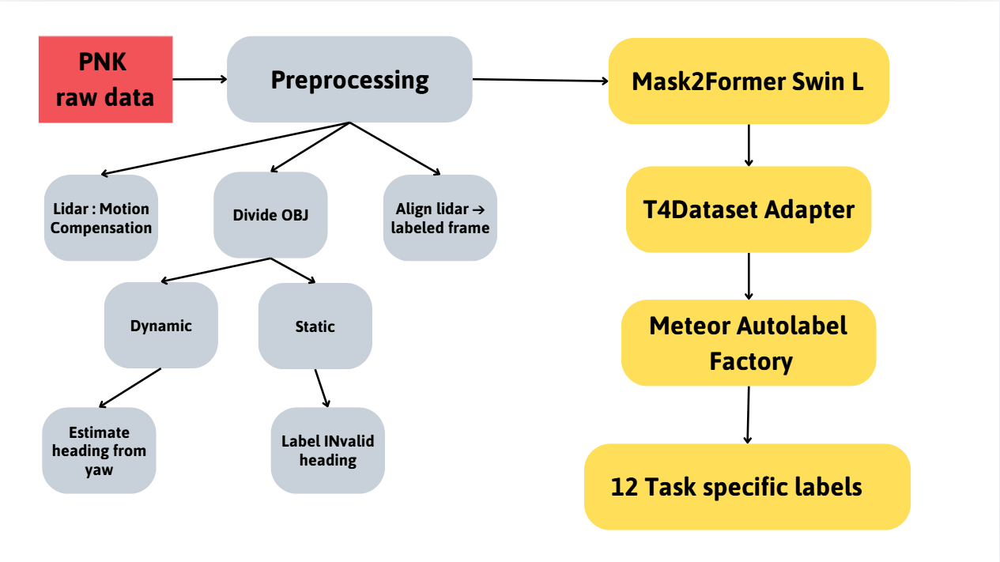
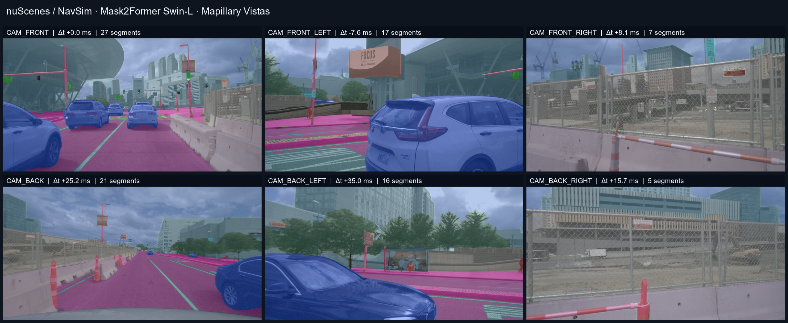
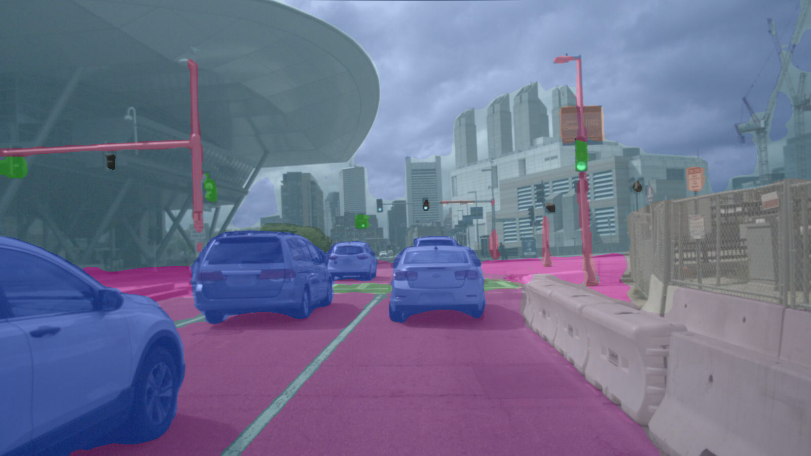
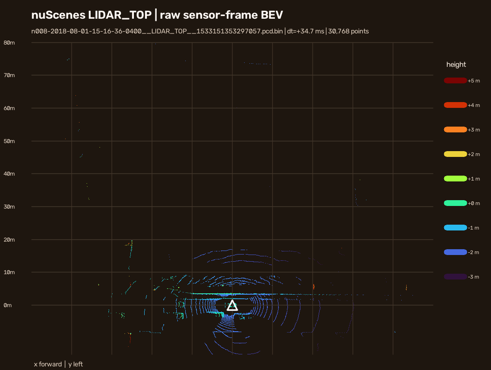

# METEOR Autolabeling

This fork explores an open-source replacement for CoMET and validates how generated annotations can enter the [TIER IV METEOR](https://github.com/tier4/METEOR) pipeline. The repository contains a PNKData end-to-end integration run and a newer camera visualization run using nuScenes data from the NavSim workflow.

> **Scope:** the NavSim preview below demonstrates Mask2Former image inference and LiDAR visualization. It does not claim that nuScenes was converted to T4Dataset or processed by the METEOR Autolabel Factory.

## Autolabel pipeline

The diagram below shows the end-to-end autolabel pipeline implemented in this fork: raw PNK data is preprocessed, camera images are labeled with Mask2Former Swin-L, annotations are adapted to T4Dataset, and METEOR's Autolabel Factory generates task-specific labels.



## NavSim / nuScenes visual run

Starting image: `n008-2018-08-01-15-16-36-0400__CAM_FRONT__1533151353262404.jpg`<br>
Dataset root: `D:\nuscenes`<br>
Model: **Mask2Former Swin-L, Mapillary Vistas Panoptic**

The contact sheet shows the six nuScenes camera views nearest to the requested timestamp, with Mask2Former panoptic overlays. Its multi-panel surround-view layout is inspired by the public [METEOR demo](https://github.com/tier4/METEOR); the six-camera layout follows the available nuScenes sensors and does not fabricate METEOR's two additional camera views.



| CAM_FRONT prediction | Raw LIDAR_TOP BEV |
|---|---|
|  |  |

The LiDAR scan is **34.7 ms** from the CAM_FRONT anchor. The BEV shows raw points in the LiDAR sensor frame; it has no projected 3D boxes or lane labels.

**[Watch the CAM_FRONT raw-to-panoptic video](docs/media/navsim_n008_cam_front_panoptic.mp4)** — 15 rendered frames at 5 FPS, sampled around the requested timestamp. The run inferred 12 unique camera images across the six-camera anchor and short front-camera sequence.

### What this run establishes

- Mask2Former inference completed on six cameras at the anchor timestamp and on nearby CAM_FRONT frames.
- The nearest camera timestamps are within **35.0 ms** of the requested CAM_FRONT timestamp.
- The run used the local CUDA environment and cached checkpoint `facebook/mask2former-swin-large-mapillary-vistas-panoptic`.
- No independent image labels were evaluated, so the segment counts and overlays are visual evidence, not accuracy metrics.
- This preview stops at camera panoptic output and raw LiDAR visualization. It does not run the T4Dataset adapter, METEOR Autolabel Factory, or METEOR training.

To reproduce it in the prepared environment:

```powershell
$env:PYTHONPATH = (Join-Path (Get-Location) 'pnk_comet_autolabel\src')
$env:HF_HOME = (Join-Path (Get-Location) 'out\pnk_e2e\hf_cache')
& '.\pnk_comet_autolabel\.venv\Scripts\python.exe' `
  '.\navsim_visuals\run_mask2former_preview.py' --device cuda
```

The [NavSim preview runner](navsim_visuals/run_mask2former_preview.py) and local run artifacts in the ignored `navsim_visuals/output/` directory make this visualization reproducible.

## PNKData end-to-end integration run

The PNK pilot demonstrates the broader replacement path from raw sensors through the METEOR Autolabel Factory. CoMET source code is not present in the public METEOR repository, so this fork uses an open-source camera segmentation model and a custom PNK-to-T4Dataset adapter.

```text
PNK raw data
  ├─ Camera RGB ──> Mask2Former Swin-L ──> 2D panoptic pseudo-labels ─┐
  └─ LiDAR_TOP + NAV + Calib_2 ──> deskew / timestamp alignment ─────┤
       PNK reference 3D boxes + heading audit ───────────────────────┘
                                  │
                                  ▼
                  Taxonomy mapping + T4Dataset adapter
                                  │
                                  ▼
             surface_ann · object_ann · sample_annotation
                                  │
                                  ▼
                   METEOR Autolabel Factory
                                  │
                                  ├─> Task targets and occupancy-flow export
                                  ├─> Training handoff smoke check
                                  └─> Frame visualizations and MP4
```

| Component | Role in the PNK pilot |
|---|---|
| [Mask2Former Swin-L, Mapillary Vistas](https://huggingface.co/facebook/mask2former-swin-large-mapillary-vistas-panoptic) | Runs on RGB images and produces semantic/panoptic predictions. It does not process LiDAR. |
| PNK preprocessing | Deskews `LIDAR_TOP` with per-point timestamps and NAV poses, aligns scans to labeled timestamps, and records camera health/synchronization evidence. |
| PNK reference annotations | Supply 3D boxes. The run audits/resolves heading where supported; it does **not** run CenterPoint. |
| T4Dataset adapter | Maps image and reference-label outputs into the schema consumed by METEOR. |
| METEOR Autolabel Factory | Converts general-purpose annotations into downstream task targets, including occupancy-flow output in this run. |
| OpenCV renderer | Writes per-frame visualizations and encodes them into MP4. |

### PNK run evidence

**Session:** `20260301_1429_VF6_01_1772350177_1772350814`<br>
**Label segment:** `290_1772350499_1772350516`<br>

| Evidence | Result |
|---|---:|
| `LIDAR_TOP` scans deskewed | 170 / 170 |
| Labeled samples | 86 |
| Camera views processed by Mask2Former | 688 / 688 |
| Views flagged as possible freeze | 252 / 688 |
| Views usable for cross-modal checks | 436 / 688 |
| General annotations: `surface_ann` | 4,695 |
| General annotations: `object_ann` | 9,132 |
| General annotations: `sample_annotation` | 10,364 |
| Occupancy-flow targets | 86 frames; 88,325 supervised BEV cells |
| Training handoff smoke check | Completed; no validation split available |

The 3D annotations come from PNK reference labels. The training smoke check verifies that data reaches the trainer; it is not a model-quality evaluation. No independent 2D ground truth was available for this session.

### Run the PNK pipeline

After setting up the environment described in the [PNK runner guide](pnk_top_autolabel/README.md), run:

```powershell
& .\pnk_top_autolabel\run_full.ps1
```

The default run reads the session above, the eight available camera streams, `LIDAR_TOP`, NAV poses, and date-matched `Calib_2`. It does not modify raw sensor files or source labels.

## Guides

- [PNK preprocessing and autolabel summary](docs/PNK_PREPROCESSING_AUTOLABEL_SUMMARY.md)
- [Dataset overview](docs/DATASET_OVERVIEW.md)
- [PNK runner guide](pnk_top_autolabel/README.md)
- [METEOR upstream repository and reference visualizations](https://github.com/tier4/METEOR)
