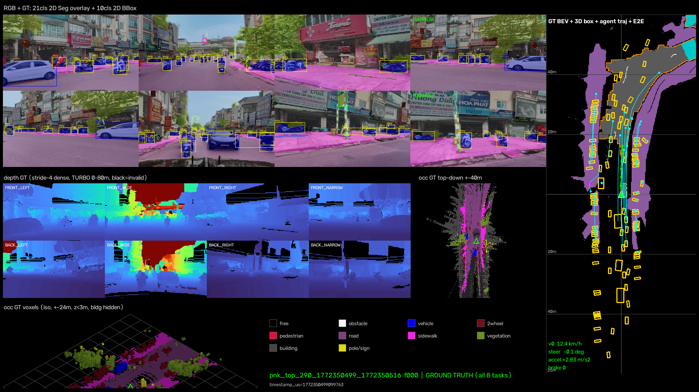
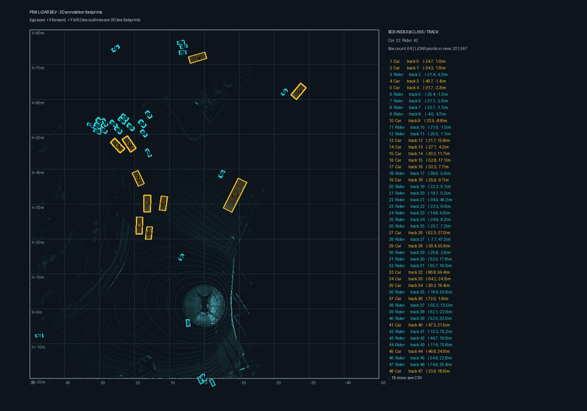

# METEOR Autolabeling on PNKData

An end-to-end autolabeling pilot for this [TIER IV METEOR](https://github.com/tier4/METEOR) fork. The pilot replaces the unavailable CoMET implementation with an open-source camera segmentation model and a PNK-to-T4Dataset adapter, then passes the generated annotations through the METEOR Autolabel Factory.

> **Scope:** this is an integration and data-flow demonstration. It is not a benchmark proving annotation accuracy or complete coverage of all METEOR tasks.

## Visual results

The frame below is from the integrated `LIDAR_TOP` run. It combines camera segmentation and object overlays with depth, BEV, occupancy, and track visualizations.



This is one rendered sample from the run. The renderer uses the label “GROUND TRUTH” for its task-target panels; that label does not mean the outputs were independently verified against ground truth.

### LiDAR and camera evidence

| Top-down LiDAR view from a separate labeled PNK frame (`1772718324-099732876`) | 3D-to-camera projection review from the integrated run |
|---|---|
|  |  |

The projection image is a visual calibration check and shows residual alignment error. Treat it as review evidence, not as a validated camera-LiDAR calibration result.

An earlier 71-frame pilot video is available here: [Watch the MP4 demo](docs/media/pnk_comet_replacement_demo.mp4). The image above and the run metrics below refer to the later `LIDAR_TOP` integration run.

## Pipeline

```text
PNK raw data
  ├─ Camera RGB ──> Mask2Former Swin-L ──> 2D panoptic pseudo-labels ─┐
  └─ LiDAR_TOP + NAV + Calib_2 ──> deskew / time alignment ──────────┤
       PNK reference 3D boxes + heading audit ───────────────────────┘
                                  │
                                  ▼
                  Taxonomy mapping + T4Dataset adapter
                                  │
                                  ▼
             General annotations: surface_ann, object_ann,
                                  sample_annotation
                                  │
                                  ▼
                   METEOR Autolabel Factory
                                  │
                                  ├─> Task targets and occupancy-flow export
                                  ├─> Training handoff smoke check
                                  └─> Per-frame visualizations and MP4
```

## Technology and responsibilities

| Component | Role in this pilot |
|---|---|
| [Mask2Former Swin-L, Mapillary Vistas](https://huggingface.co/facebook/mask2former-swin-large-mapillary-vistas-panoptic) | Runs on camera RGB and produces 2D semantic/panoptic predictions. It does not process LiDAR. |
| PNK preprocessing | Deskews `LIDAR_TOP` using per-point timestamps and NAV poses, aligns scans to labeled timestamps, and records camera health/synchronization evidence. |
| PNK reference annotations | Supply the 3D boxes. The pilot audits/resolves heading where supported; it does **not** run CenterPoint. |
| T4Dataset adapter | Maps model and reference-label outputs into the schema METEOR consumes. |
| METEOR Autolabel Factory | Converts general-purpose annotations into downstream task targets, including the occupancy-flow export in this run. |
| OpenCV renderer | Writes per-frame visualization images and encodes them into an MP4. |

## Integrated run

**Session:** `20260301_1429_VF6_01_1772350177_1772350814`<br>
**Label segment:** `290_1772350499_1772350516`<br>
**Raw data:** `D:\mentor_data\PNKData\20260301_1429_VF6_01_1772350177_1772350814`

| Evidence | Result |
|---|---:|
| `LIDAR_TOP` scans deskewed | 170 / 170 |
| Labeled samples | 86 |
| Camera views processed by Mask2Former | 688 / 688 |
| Views flagged as possible freeze | 252 / 688 |
| Views marked usable for cross-modal checks | 436 / 688 |
| General annotations: `surface_ann` | 4,695 |
| General annotations: `object_ann` | 9,132 |
| General annotations: `sample_annotation` | 10,364 |
| Occupancy-flow targets | 86 frames; 88,325 supervised BEV cells |
| Training handoff smoke check | Completed; no validation split was available |

The 3D annotations come from the PNK reference labels. The training smoke check verifies that data reaches the trainer; it is not a model-quality evaluation. No independent 2D ground truth was available for accuracy metrics on this session.

## Reproduce the run

After setting up the environment described in the [PNK runner guide](pnk_top_autolabel/README.md), run:

```powershell
& .\pnk_top_autolabel\run_full.ps1
```

The default run uses the session and label segment listed above. It reads `LIDAR_TOP`, the eight available camera streams, NAV poses, and the date-matched `Calib_2`. Raw sensor files and source labels are not modified.

## Repository guides

- [PNK preprocessing and autolabel summary](docs/PNK_PREPROCESSING_AUTOLABEL_SUMMARY.md)
- [Dataset overview](docs/DATASET_OVERVIEW.md)
- [PNK runner guide](pnk_top_autolabel/README.md)
- [METEOR upstream repository](https://github.com/tier4/METEOR)

## Current limitations

- CoMET source code is not available in this repository; this pilot uses an open-source replacement.
- PNK 3D reference boxes are passed through the adapter; CenterPoint inference has not been evaluated here.
- Camera/LiDAR calibration still needs further validation. Some views are flagged for possible freeze and are not suitable as reliable cross-modal evidence.
- Generated annotations are pseudo-labels. The run verifies the pipeline and schema handoff, not accuracy against independent ground truth or full completion of all METEOR task labels.
