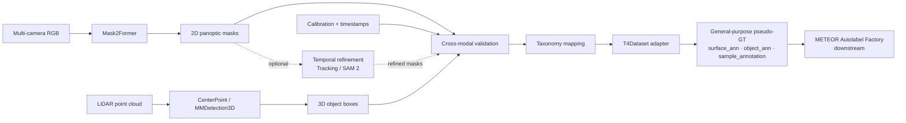

# COMET Replacement: Implementation Plan

## Mục tiêu

Repository hiện tại là fork của [TIER IV / METEOR chính chủ](https://github.com/tier4/METEOR) (remote `origin` trỏ tới fork `hoangducanh2005/METEOR_test`). Implementation cần nối vào schema, factory và training code có sẵn trong fork; không xây một nhánh METEOR downstream song song.

Xây dựng một **upstream open-source autolabeling pipeline** để tạo General-Purpose Ground Truth / pseudo-GT cho METEOR từ dữ liệu camera, LiDAR và calibration của T4Dataset.

Kế hoạch này không phụ thuộc vào CoMET: implementation/source code cần để tái tạo upstream labeling không được cung cấp trong public METEOR repository. Output của pipeline thay thế tương thích với các annotation mà METEOR downstream đọc được; sau đó mới đưa sang **METEOR Autolabel Factory** để sinh task-specific GT.

Phạm vi bản đầu gồm Mask2Former cho panoptic 2D, CenterPoint qua MMDetection3D cho object 3D, custom taxonomy mapper và T4Dataset adapter. Tracking/SAM 2 là phần mở rộng tùy chọn.

## Tech stack

| Thành phần | Implementation dự kiến | Input | Công việc | Output |
|---|---|---|---|---|
| 2D panoptic autolabeling | [Mask2Former Swin-L, Mapillary Vistas](https://huggingface.co/facebook/mask2former-swin-large-mapillary-vistas-panoptic) ([repository](https://github.com/facebookresearch/Mask2Former)) | RGB từ từng camera | Phân đoạn semantic và instance cho `stuff` (road, sidewalk, lane, ...) và `thing` (car, pedestrian, ...) | Panoptic mask gồm `class_id`, `instance_id`, `mask`; chuyển thành `surface_ann`, `object_ann` |
| 3D object autolabeling | [CenterPoint trong MMDetection3D](https://github.com/open-mmlab/mmdetection3d/tree/main/configs/centerpoint) ([MMDetection3D](https://github.com/open-mmlab/mmdetection3d)) | LiDAR point cloud | Phát hiện và phân loại dynamic objects trong hệ tọa độ 3D | Box `(class, x, y, z, l, w, h, yaw, score)`; chuyển thành `sample_annotation` |
| Temporal refinement (optional) | [SAM 2](https://github.com/facebookresearch/sam2) hoặc [Grounded SAM 2](https://github.com/IDEA-Research/Grounded-SAM-2) | Panoptic masks / object sequence `t-N:t+N` | Propagate hoặc refine mask qua các frame; hỗ trợ duy trì instance ID và giảm flicker | Mask/instance ID nhất quán theo thời gian |
| Cross-modal validation | Custom camera–LiDAR geometry | 2D masks, 3D boxes, calibration | Chiếu box/điểm LiDAR vào camera để đo consistency và tạo confidence | Pseudo-label được xác thực/lọc, kèm confidence |
| Taxonomy mapping | Custom mapper, cấu hình versioned | Mapillary và CenterPoint classes | Ánh xạ class sang taxonomy METEOR/T4Dataset; class không ánh xạ được chuyển `ignore`/unknown theo policy | Unified `class_id` và category mapping |
| Dataset adapter | Custom T4Dataset converter | Pseudo-label từ các bước trên | Chuyển annotation và metadata vào schema mà METEOR pipeline đọc được | `surface_ann`, `object_ann`, `sample_annotation` |

**License gate:** mã nguồn model và pretrained weights/dataset có thể mang điều khoản khác nhau. Trước khi phát hành hoặc phân phối lại checkpoint/pseudo-GT, cần ghi nhận và rà soát license của từng dependency, checkpoint và dữ liệu nguồn.

## Pipeline tổng thể



```text
Raw sensors (multi-camera RGB + LiDAR + calibration)
    → Mask2Former + CenterPoint
    → 2D panoptic masks + 3D boxes
    → cross-modal validation
    → taxonomy mapping
    → T4Dataset adapter
    → General-Purpose Pseudo-GT
    → METEOR Autolabel Factory (downstream)
```

## Output contract

```text
GT_general = {
    surface_ann,       # 2D stuff / surface regions
    object_ann,        # 2D thing instances
    sample_annotation # 3D objects
}
```

- `surface_ann`: semantic mask cho các lớp stuff/surface; lưu đúng image/camera/frame reference của T4Dataset.
- `object_ann`: mask và category của từng thing instance, gắn `instance_id` ổn định trong phạm vi scene/track đã quy định.
- `sample_annotation`: oriented 3D box và category; lưu vị trí, kích thước, yaw trong coordinate frame mà T4Dataset yêu cầu.
- `score`/confidence, model/checkpoint version, taxonomy version và provenance phải được giữ trong field được schema hỗ trợ hoặc sidecar metadata. Không thêm field tùy ý làm hỏng reader hiện tại.
- Adapter là ranh giới duy nhất giữa output nội bộ của model và schema T4Dataset. Schema cụ thể, cách mã hóa mask, token/reference, đơn vị, handedness, chiều trục và coordinate frame phải được xác nhận với reader/validator hiện có trước khi chốt serialization.

## Kế hoạch triển khai

### Phase 0 — Chốt contract dữ liệu

1. Chọn một scene nhỏ đại diện, gồm đủ camera, LiDAR, ego pose và calibration.
2. Kiểm tra timestamp synchronization, camera order/resolution, LiDAR format, transform chain và convention của coordinate frame.
3. Đối chiếu schema `surface_ann`, `object_ann`, `sample_annotation` mà METEOR hiện đọc; xác định encoding mask và quy tắc ID/reference.
4. Tạo golden input scene và validator cho output adapter trước khi chạy model trên toàn bộ dữ liệu.

**Deliverable:** tài liệu schema/coordinate convention ngắn, scene fixture và validator có thể báo lỗi rõ ràng khi thiếu field hoặc transform sai.

### Phase 1 — Baseline 2D và 3D độc lập

1. Chạy Mask2Former Swin-L Mapillary Vistas trên từng camera; xuất semantic category, thing masks/instance và score thô.
2. Chạy CenterPoint trên LiDAR; chọn checkpoint/config phù hợp nhất với sensor và domain, rồi đo trên các scene pilot.
3. Chuẩn hóa output nội bộ của hai model về format trung gian độc lập với T4Dataset.
4. Nếu checkpoint pretrained không đạt độ bao phủ/độ chính xác cần thiết cho T4Dataset, chuẩn bị bước fine-tune hoặc chuyển đổi dữ liệu phù hợp trước khi mở rộng.

**Deliverable:** inference có thể resume theo scene/frame; preview 2D mask và 3D box; báo cáo per-class coverage/score trên pilot.

### Phase 2 — Taxonomy và cross-modal validation

1. Tạo mapping có version từ Mapillary class IDs và CenterPoint classes sang taxonomy METEOR/T4Dataset. Mỗi class có đích rõ ràng hoặc policy `ignore`/unknown.
2. Project LiDAR points và 3D box corners qua calibration vào từng camera nhìn thấy object.
3. Tính consistency theo class, visibility/occlusion và overlap hình học; ghi confidence và lý do bị lọc.
4. Dùng ngưỡng ban đầu trên pilot, hiệu chỉnh bằng các ví dụ được render; đóng băng ngưỡng theo config version để kết quả có thể tái tạo.

**Deliverable:** taxonomy map versioned; ảnh overlay 2D/3D; pseudo-label đã validate cùng confidence/provenance.

### Phase 3 — T4Dataset adapter và downstream handoff

1. Chuyển semantic/stuff masks thành `surface_ann`, thing masks thành `object_ann`, và 3D boxes thành `sample_annotation`.
2. Ghi metadata run: model/checkpoint ID hoặc digest, config, thresholds, taxonomy version, scene/frame IDs và thời điểm tạo.
3. Chạy validator trên golden scene và một batch pilot; kiểm tra references, dimensions, mask encoding, class IDs, coordinate frame, đơn vị và tính duy nhất của IDs.
4. Đưa output vào một run của METEOR Autolabel Factory và xác nhận downstream đọc được, tạo được các task-specific GT hiện hành.

**Deliverable:** adapter idempotent, schema validation và ví dụ output hoàn chỉnh đi qua downstream.

### Phase 4 — Temporal refinement (optional)

1. Chỉ bật sau khi baseline single-frame qua validation.
2. Thử tracker theo detection/instance trước; dùng SAM 2 để propagate/refine mask của các track có seed rõ ràng.
3. Đo thay đổi về mask flicker, ID switches, track fragmentation và lỗi lan truyền từ seed sai.
4. Giữ refinement dưới dạng stage có thể bật/tắt; so sánh với baseline trước khi dùng cho toàn bộ dataset.

SAM 2 chủ yếu propagate/refine mask từ prompt hoặc seed. Nó không thay taxonomy mapper và không tự bảo đảm khôi phục mọi detection bị bỏ sót. Grounded SAM 2 có thể được thử nếu cần grounding/detection bổ sung, nhưng cần đánh giá chất lượng, throughput và license riêng.

**Deliverable:** benchmark temporal tùy chọn, metrics và cấu hình bật/tắt.

### Phase 5 — Scale-out và vận hành

1. Chạy theo scene với cache/checkpoint/resume; lưu model/config digest cùng mọi output.
2. Theo dõi throughput, GPU memory, tỷ lệ frame lỗi, tỷ lệ class mapped/ignored và số annotation bị cross-modal filter.
3. Chia train/validation/test theo recording, không chia frame liền kề giữa các split.
4. Xuất summary và visualization theo scene để phát hiện scene hỏng, calibration lệch hoặc domain shift trước downstream training.

**Deliverable:** batch runner ổn định, run manifest, quality report và pseudo-GT dataset có thể truy nguyên.

## Tiêu chí nghiệm thu

- Chạy end-to-end trên pilot scene từ raw sensor đến ba nhóm annotation và được METEOR downstream đọc thành công.
- Mapping taxonomy đầy đủ, versioned; class chưa hỗ trợ không bị gán nhầm sang class khác.
- Projection camera–LiDAR trên fixture xác nhận đúng hướng trục, transform và đơn vị; visualization cho thấy lỗi dễ nhận biết.
- Validator bắt được annotation thiếu reference, sai kích thước mask, ID lỗi/trùng theo quy ước, class ngoài taxonomy và box ngoài coordinate contract.
- Có per-class coverage/score, số lượng nhãn trước/sau filtering và mẫu visualization cho mỗi run.
- Có thể resume scene bị gián đoạn và tái tạo kết quả từ cùng input, checkpoint, config và taxonomy.
- Temporal refinement chỉ được bật khi benchmark pilot chứng minh cải thiện chỉ số temporal mà không làm tăng lỗi lan truyền vượt mức chấp nhận đã định trước.

Ngưỡng số cụ thể cho precision/coverage, consistency và throughput sẽ được đặt sau pilot dựa trên phân bố dữ liệu và nhu cầu của METEOR; không suy diễn các ngưỡng này từ benchmark pretrained bên ngoài.

## Rủi ro cần xử lý

| Rủi ro | Cách xử lý trong kế hoạch |
|---|---|
| Taxonomy Mapillary/CenterPoint khác METEOR/T4Dataset | Versioned mapping; kiểm tra class coverage; class không rõ chuyển ignore/unknown |
| Pretrained checkpoint lệch domain hoặc sensor | Pilot theo điều kiện dữ liệu; đánh giá per-class; fine-tune khi cần |
| Sai calibration hoặc timestamp gây mismatch 2D–3D | Golden geometry fixture, reprojection overlay và kiểm tra synchronization ở Phase 0 |
| Occlusion làm cross-modal filter loại nhãn đúng | Tính visibility; chỉ dùng geometry làm tín hiệu confidence/filter có thể giải thích |
| Tracking làm lan truyền lỗi mask hoặc ID | Giữ optional; đánh giá trên sequence và có thể fallback về per-frame output |
| License của code, checkpoint và dữ liệu khác nhau | Rà soát riêng trước khi phát hành/distribute model hoặc pseudo-GT |

## Tối thiểu để bắt đầu

```text
Mask2Former + CenterPoint + Custom Taxonomy Mapper + T4Dataset Adapter
```

Cross-modal validation nên có ngay trong pilot để phát hiện lỗi đồng bộ/calibration và gắn confidence. Tracking/SAM 2 có thể thêm sau khi baseline schema và chất lượng single-frame ổn định.

## Ưu tiên số 1: E2E test trên một folder PNKData đầy đủ

Các giải pháp dưới đây dựa trên [DATASET_OVERVIEW.md](DATASET_OVERVIEW.md) và kiểm kê trực tiếp folder pilot.

Mục tiêu của pilot là chứng minh được luồng:

```text
PNKData raw folder
  → PNK importer + CoMET replacement
  → T4Dataset General-Purpose annotations
  → METEOR Autolabel Factory
  → một smoke training run của METEOR
```

Pilot dùng toàn bộ folder bên dưới, không chỉ một vài frame. **Phạm vi camera cố định là 8 camera pinhole**; bỏ qua 4 camera fisheye và không triển khai nhánh xử lý rig 12 camera trong test này.

```text
Raw folder:
D:\mentor_data\PNKData\20260301_1443_VF6_01_1772350996_1772351781

Calibration:
D:\mentor_data\PNKData_meta_fresh\Calib_2

3D labels để đánh giá:
D:\mentor_data\PNKData_meta_fresh\label\2026_08_14_vf6_01_02\295_1772351165_1772351179\label
```

### Đã xác nhận trong folder mục tiêu

- Metadata CSV ánh xạ folder này thành segment `295_1772351165_1772351179`, `3d_annotated=1`, `num_frames=71`, `num_boxes=9038`.
- Thư mục label có 71 file `.txt`, timestamp set khớp chính xác với 71 mốc của `LIDAR_MERGED_EGO`; metadata ghi tổng cộng 9.038 boxes. Dùng chúng làm **evaluation reference** cho 3D, không dùng chính folder kiểm thử để fine-tune rồi báo metric trên cùng dữ liệu.
- Tám thư mục pinhole có 417–420 ảnh mỗi camera; `LIDAR_MERGED_EGO` có 71 `.laz` ở khoảng 5 Hz. Bốn LiDAR riêng lẻ có khoảng 140 `.laz` mỗi loại ở khoảng 10 Hz.
- `OTHERS` chứa CSV theo lát thời gian của cả chuyến. Metadata ghi ngày chạy là 2026-03-01 nên phải chọn dải extrinsics `2026-02-28_2026-03-19` trong `VF6_01_Extrinsics_By_Dates.json`.
- Đã kiểm tra ghép timestamp bằng integer nanoseconds: cả 71 LiDAR anchors đều có đủ 8 ảnh gần nhất (568 cặp), không ảnh nào bị tái sử dụng; lệch camera–LiDAR lớn nhất là `2.113 ms`, p95 `2.037 ms`, không cặp nào vượt `35 ms`, và camera spread của các nhóm đã match là `0 ms`. Với folder này, ngưỡng sync không làm rơi frame; vẫn giữ bộ lọc để xử lý folder khác hoặc khoảng dropout.

### Visual deliverable bắt buộc

Hình tham chiếu là [`docs/deliverables_ expected/image.png`](<deliverables_ expected/image.png>). Video cho folder phải ghép các frame theo timestamp và giữ layout/nhóm thông tin tương đương:

1. **Dải camera:** RGB của đủ 8 camera pinhole, overlay **21-class 2D segmentation** và 10-class 2D boxes.
2. **Dải depth:** metric depth GT cho camera views có output hợp lệ.
3. **Occupancy:** top-down và voxel/isometric visualization.
4. **BEV:** lane/surface GT, oriented 3D boxes, agent trajectories và ego trajectory/E2E signals.


Per-frame artifact là montage PNG `1920×1080`; output toàn folder là MP4 được tạo từ các montage đã sắp theo timestamp. `demo_gt_full.py` hỗ trợ `--frames-dir` để lưu PNG của từng frame bên cạnh video và tự giữ MP4 `mp4v` khi máy không có `ffmpeg`. Lưu PNG, video, manifest và report dưới `out/pnk_e2e/reports/`; giữ một frame tương ứng cho mỗi sample mà factory xuất ra. Dùng timestamp/scene/frame trong overlay hoặc sidecar để trace frame trong video về raw input.

**Segmentation là gate bắt buộc.** Mask2Former output phải được taxonomy mapper chuyển thành 21-class METEOR segmentation và đi qua schema `surface_ann`/`object_ann`; downstream factory phải tạo `seg2d21` cho đủ 8 camera trong từng sample được đưa vào video. Trước render, validator phải kiểm tra file tồn tại, decode được, có class ID hợp lệ, đúng kích thước và có pixel được gán nhãn. Nếu thiếu segmentation ở bất kỳ sample nào, dừng bước render/pass, ghi `FAIL: missing seg2d21` cùng scene/frame/camera và nhắc người chạy bổ sung segmentation. Không để renderer lặng lẽ bỏ trống overlay rồi tạo video trông như thành công.

### Cách khắc phục sáu vấn đề dữ liệu cho pilot

| Vấn đề | Cách xử lý cho folder test | Điều kiện kiểm tra |
|---|---|---|
| Rớt frame giữa 8 camera | Parse tên file thành integer nanoseconds; lấy từng timestamp `LIDAR_MERGED_EGO` làm anchor; tìm ảnh gần nhất riêng trong 8 camera. Không ghép theo index và không tái sử dụng ảnh cho hai keyframe nếu dữ liệu cho phép chọn ảnh khác. | Ghi lại đủ 8 delta camera–anchor; yêu cầu độ lệch giữa các camera cùng nhóm `≤15 ms`. Nếu một camera lệch khỏi anchor `>35 ms`, đánh dấu view thiếu và loại sample đó khỏi train đa camera; không xóa LiDAR-only result. |
| Camera/LiDAR khác tần số và lệch pha | Dùng 71 mốc `LIDAR_MERGED_EGO` làm keyframe 3D; mỗi keyframe lấy nearest image cho từng camera. Lưu timestamp thật của từng cảm biến, không gán timestamp LiDAR giả cho ảnh. | Báo số keyframe đầu vào, số frame match đủ 8 view, phân vị độ lệch camera–LiDAR và số frame bị loại theo từng lý do. |
| Camera freeze/dropout | Tính khoảng cách đến ảnh tốt nhất bằng timestamp; tuyệt đối không forward-fill ảnh cũ khi delta `>35 ms`. Một sample có thể giữ được nhãn 3D từ LiDAR nhưng không được gắn nhãn 2D như thể camera còn đồng bộ. | Báo gap lớn nhất theo camera, các khoảng gap `>50 ms`, và số sample mất ít nhất một view. Kiểm tra bằng contact sheet quanh gap. |
| Rolling sweep / motion distortion | Dùng `point_timestamp` cùng trajectory nội suy từ NAV/IMU để deskew theo từng điểm trước khi projection/fusion; chuẩn hóa về `t_ref` và lưu quy tắc frame/time trong run metadata. | Overlay LiDAR đã deskew lên ảnh và box reference ở đầu/cuối sweep; so sánh trước/sau. Không coi `LIDAR_MERGED_EGO` là đã/ chưa deskew cho đến khi kiểm tra dữ liệu và xác nhận producer của file. Không deskew lần hai. |
| Lệch pha 3.788 ms giữa LiDAR nóc và ngoại vi | Bản MVP dùng `LIDAR_MERGED_EGO` có sẵn để tránh ghép lại 5 sensor. Chỉ khi phải tạo merged cloud mới từ 5 LiDAR thì mới bù temporal offset trong merge; xác nhận chiều dấu bằng timestamp/overlay, không hard-code dấu theo mô tả mơ hồ. | Log nguồn point cloud được dùng và trạng thái bù offset; bảo đảm offset chỉ áp dụng một lần. So sánh mép vật thể gần xe với label reference. |
| CSV phụ trợ dài hơn segment | Xác định `t_min/t_max` từ camera/LiDAR của folder; đọc CSV theo chunk và chỉ giữ cửa sổ `[t_min−2 s, t_max+2 s]`, sort/deduplicate theo timestamp rồi nội suy pose/speed. | Báo số dòng đọc/giữ và timestamp coverage; không load toàn bộ chuyến vào RAM. Frame nằm ngoài coverage pose bị đánh invalid, không được extrapolate xa. |

### Thứ tự chạy toàn folder

1. **Preflight và manifest** — quét tất cả timestamp trong folder, xác nhận đúng 8 `CAM_P_*` pinhole, 71 merged-LiDAR samples, label files và calibration date range. Xuất `preflight.json` gồm count, gap, timestamp range, class counts và mọi lỗi; raw folder chỉ đọc.
2. **Chuẩn hóa PNK inputs** — dùng allowlist 8 camera pinhole; tạo rig map từ sensor ID sang 8 slot METEOR dựa trên extrinsics/yaw đã kiểm tra bằng projection. Ảnh gốc là `1920×1536`, khác aspect ratio đầu vào METEOR `768×432`: resize/crop/pad phải giữ đúng phép biến đổi ảnh và cập nhật intrinsic `K` tương ứng, không kéo méo ảnh rồi giữ nguyên `K`.
3. **Inference toàn bộ dải keyframe của folder** — chạy Mask2Former trên `71×8` ảnh đã match. Đây là toàn bộ 14 giây dữ liệu ở nhịp keyframe 5 Hz dùng chung với LiDAR; các ảnh 30 Hz còn lại không tạo thêm sample train trong pilot này. Temporal refinement tắt để baseline single-frame có thể kiểm tra độc lập. Backend CenterPoint vẫn là hạng mục production tiếp theo; pilot hiện dùng nhãn 3D có sẵn làm bridge và ghi provenance `reference_3d_bridge_for_e2e_flow_test` trong từng box.
4. **Evaluation và taxonomy** — khi CenterPoint backend được nối vào, đối chiếu prediction với 71 file nhãn và báo precision/recall/center error/yaw error riêng cho `Car`, `Rider`, `Pedestrian`. Theo thống kê tổng thể trong DATASET_OVERVIEW, Rider chiếm 55.28% PNKData, vì vậy không chấp nhận chỉ báo metric gộp. Run thông luồng hiện tại không báo metric CenterPoint vì đầu vào 3D là reference bridge, không phải prediction.
5. **Xuất General-Purpose annotations** — ghi một scene staging có T4Dataset `annotation/` và `data/`, chứa `surface_ann`, `object_ann`, `sample_annotation`, camera calibration/poses, point cloud reference, confidence và provenance. Tên/ID channel được tạo từ rig map; ảnh/mask cùng kích thước và cùng intrinsic sau preprocessing. Không ghi vào raw folder.
6. **Chạy METEOR Autolabel Factory** — đặt scene đã convert trong `out/allroot/<scene>` và scene name vào `out/pnk_e2e_scenes.txt`, rồi chạy:

   ```powershell
   python bevlane/convert_dtset.py --scenes out/pnk_e2e_scenes.txt --workers 1 --stride 1
   ```

   Orchestrator chạy lần lượt `run_batch.py`, vectorization, `extract_gt`, `render_vector_gt` và các extractor depth/box/seg2d/ego/occupancy/risk/unknown. `convert_dtset.py` đã nhận `--stride` và truyền giá trị này xuyên suốt để pilot giữ đủ 71 LiDAR keyframe. Giữ một worker để lỗi stage đầu tiên dễ định vị; chỉ chuyển sang train khi mọi stage bắt buộc có output và log `[ok]`.
7. **METEOR training smoke** — đưa đúng scene vào train list, giới hạn vài sample, `batch=1`, `workers=0`, `epochs=1`; xác nhận loader đọc đủ 8 ảnh/calibration/GT, loss hữu hạn qua ít nhất một optimizer step và checkpoint được ghi dưới `out/pnk_e2e/`. Đây chỉ là kiểm tra tương thích dữ liệu và train path, không phải kết quả accuracy. Dùng 3D labels của segment để đánh giá độc lập, không trộn vào loss của pseudo-GT run.
8. **Render deliverable** — kiểm tra segmentation gate, rồi tạo PNG cho mọi frame output và ghép MP4 theo timestamp. Fork đã có renderer GT-only với layout phù hợp là `bevlane/demo_gt_full.py`; bổ sung cờ lưu PNG frame nếu cần lưu riêng từng montage:

   ```powershell
   python bevlane/demo_gt_full.py --scenes-file out/pnk_e2e_scenes.txt `
     --out out/pnk_e2e/reports/pnk_295_gt_full.mp4 --frames-dir out/pnk_e2e/reports/frames `
     --fps 5 --frame-stride 1 --require-segmentation
   ```

   Video thể hiện GT đã tạo qua pipeline, không phải video prediction của METEOR model. Gắn trạng thái `GROUND TRUTH` và chỉ coi là deliverable khi segmentation overlay hiện trên đủ các camera/frame.
9. **Báo cáo kết quả** — lưu `preflight.json`, manifest/run config, model/checkpoint digests, số annotation theo class, valid/dropped samples, output từng factory stage, segmentation coverage, log train, PNG montages và MP4 tại `out/pnk_e2e/reports/`.

### Điều kiện pass của luồng E2E

- Đã xử lý toàn bộ dải thời gian camera/LiDAR của folder, không chỉ smoke trên một frame; mọi frame bị loại đều có lý do và được thống kê.
- Khi bật CenterPoint production backend: 3D predictions đối chiếu được với 71 file nhãn và class `Rider` có metric riêng. Reference bridge chỉ chứng minh luồng schema, không thỏa gate chất lượng 3D này.
- T4Dataset validator đọc được ba nhóm annotation; token/reference, category, RLE, dimensions, timestamp và coordinate frame đều hợp lệ.
- `seg2d21` có đủ cho mọi frame/camera được xuất; video phải có overlay 21-class segmentation nhìn thấy được. Thiếu segmentation là **FAIL**, phải nhắc người chạy và không đánh dấu luồng E2E hoàn thành.
- METEOR Autolabel Factory hoàn tất các stage cần cho training và `BevLaneDataset` đọc được scene sau conversion.
- METEOR thực hiện được một optimizer step hữu hạn trên sample từ scene đó.
- Có PNG cho từng montage và một MP4 theo thứ tự timestamp, layout tương đương hình trong `docs/deliverables_ expected/image.png`.

### Kết quả thực thi pilot ngày 2026-09-28

- Preflight nhận `71/71` LiDAR keyframe, match đủ `568/568` camera view, không drop sample. Camera–LiDAR delta lớn nhất `2.113 ms`, p95 `2.037 ms`.
- T4 staging có 71 sample, 639 sample-data record, 568 ảnh đã undistort/resize và 71 point cloud `float32 Nx5`.
- Mask2Former Swin-L Mapillary Vistas chạy trên RTX 4050 bằng CUDA 12.8 và tạo 9.147 panoptic annotation đã map. Contract validator decode kiểm tra đủ 568 view, gồm `road`, `sidewalk`, lane/crosswalk, vehicle, VRU, sign/light và environment classes.
- 3D bridge chứa 9.038 box, 686 instance/track. Đây là nhãn reference có provenance rõ ràng; CenterPoint chưa chạy và không có metric 3D prediction trong kết quả này.
- METEOR Autolabel Factory hoàn tất với `[ok]` ở stride 1. Gate `seg2d21` pass 71 frame × 8 camera, không view nào all-ignore và class ID đều nằm trong 0–20.
- Renderer tạo 71 PNG `1920×1080` và MP4 71 frame, 5 fps, có segmentation overlay. Artifacts nằm dưới `out/pnk_e2e/reports/`.
- METEOR `v3s` thực hiện một optimizer step với batch 1 trên 8 camera và ghi `out/pnk_e2e/train_smoke/last.pt`; 170 tensor trong checkpoint đều hữu hạn. Validation metric không áp dụng vì pilot một scene không có validation split độc lập.

**Trạng thái segmentation:** **PASS** cho thông luồng pilot. Nếu chạy folder khác và thiếu bất kỳ `seg2d21` view nào, validator và renderer dừng với `FAIL: missing seg2d21`.

Lệnh tái tạo toàn bộ run nằm trong [`pnk_comet_autolabel/run_pilot.ps1`](../pnk_comet_autolabel/run_pilot.ps1). Hướng dẫn môi trường, CUDA và provenance 3D nằm trong [`pnk_comet_autolabel/README.md`](../pnk_comet_autolabel/README.md).

## Tech stack links

- [Mask2Former — official GitHub](https://github.com/facebookresearch/Mask2Former)
- [Mask2Former Swin-L, Mapillary Vistas, panoptic — Hugging Face](https://huggingface.co/facebook/mask2former-swin-large-mapillary-vistas-panoptic)
- [CenterPoint configs and model notes — MMDetection3D](https://github.com/open-mmlab/mmdetection3d/tree/main/configs/centerpoint)
- [MMDetection3D — official GitHub](https://github.com/open-mmlab/mmdetection3d)
- [SAM 2 — official GitHub](https://github.com/facebookresearch/sam2)
- [Grounded SAM 2 — official GitHub](https://github.com/IDEA-Research/Grounded-SAM-2)
- [TIER IV METEOR — downstream repository](https://github.com/tier4/METEOR)
- [METEOR data pipeline notes](DATA_PIPELINE.md)
- [PNKData dataset overview](DATASET_OVERVIEW.md)
