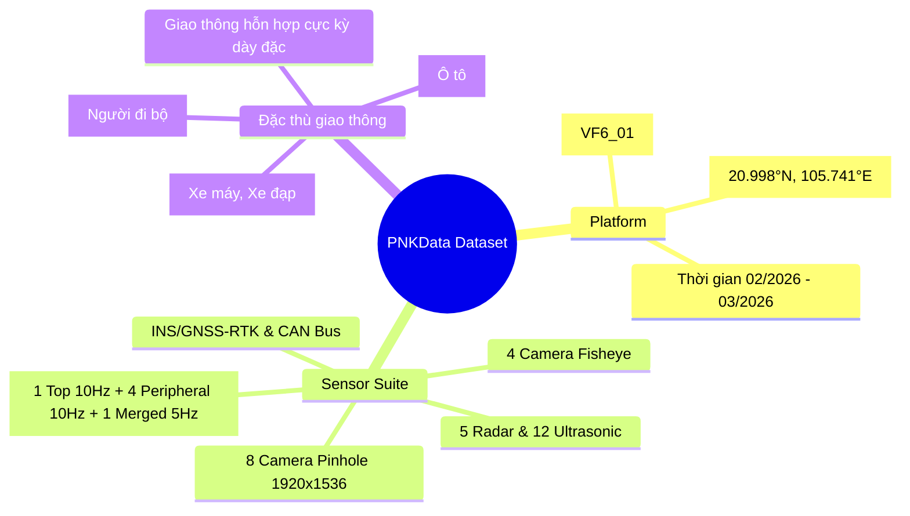
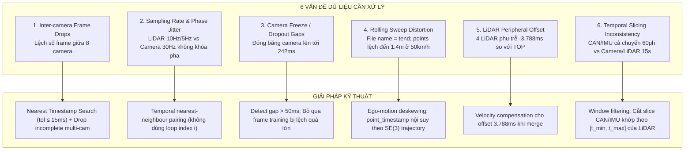

# METEOR / PNKData: Tổng quan Bộ Dữ liệu Thực địa & Cẩm nang Kỹ thuật (Dataset Overview)

> **Đường dẫn lưu trữ dữ liệu nguồn:** `D:\mentor_data`  
> **Phiên bản hiệu chuẩn áp dụng:** `PNKData_meta_fresh/Calib_2`  
> **Lưu ý cốt lõi:** Tuyệt đối **KHÔNG** sử dụng thư mục `Calib` cũ (phiên bản lỗi). Bắt buộc sử dụng `Calib_2` cho toàn bộ quá trình nạp thông số nội/ngoại suy và chiếu tọa độ.

---

## 1. Tổng quan sơ bộ về bộ dữ liệu (Dataset Overview)

Tập dữ liệu **PNKData** là bộ dữ liệu tự hành đa cảm biến (Multi-modal Autonomous Driving Dataset) được thu thập từ xe điện vận hành thực tế trên đường phố đô thị Việt Nam. Đây là nguồn dữ liệu thực địa quý giá phục vụ nghiên cứu và huấn luyện các mô hình nhận thức không gian 3D (3D Object Detection, BEV Segmentation, Metric Depth, Occupancy Network, End-to-End Autonomous Driving).



### 1.1 Đối tượng & Phương tiện thu thập
* **Dòng xe thử nghiệm:** Xe điện thông minh **VinFast VF 6**.
* **Mã định danh xe:** `VF6_01`.
* **Địa bàn vận hành thực tế:** Tuyến đường giao thông hỗn hợp tại khu vực **Hà Nội, Việt Nam**. Tọa độ GPS danh định ghi nhận tập trung quanh khu vực $20.998^\circ\text{N}, 105.741^\circ\text{E}$ (khu vực phía Tây Hà Nội: trục Tố Hữu, Lê Văn Lương kéo dài, Nam Từ Liêm, Hà Đông, đường gom Đại lộ Thăng Long).
* **Môi trường hoạt động:** Giao thông đô thị mật độ cao vào ban ngày, giờ cao điểm, các nút giao phức tạp, nhiều vòng xuyến và đường nhánh hẹp.

### 1.2 Thời gian thu thập
* **Khoảng thời gian:** Các đợt chạy thu thập dữ liệu diễn ra từ **cuối tháng 02/2026 đến tháng 03/2026**.
* **Dải Unix Timestamp:** Tương ứng với mốc thời gian Unix epoch `~1.772109e9` (ví dụ `1772109...` - `1772861...`).

### 1.3 Hệ thống cảm biến phần cứng (Sensor Suite)

Hệ thống xe thu thập `VF6_01` được trang bị tổ hợp cảm biến đồng bộ đa tầng bao quát $360^\circ$ quanh thân xe:

| Phân loại cảm biến | Tên định danh (Sensor ID) | Số lượng | Độ phân giải / Tần số | Mô tả & Góc quan sát |
| :--- | :--- | :---: | :---: | :--- |
| **Pinhole Camera** | `CAM_P_F`, `CAM_P_B`, `CAM_P_FL`, `CAM_P_FR`, `CAM_P_L`, `CAM_P_LB`, `CAM_P_R`, `CAM_P_RB` | 8 | $1920 \times 1536$ @ ~30Hz danh định | 8 camera thị giác máy độ phân giải cao, ghép thành vòng tròn quan sát $360^\circ$ không điểm mù quanh xe. |
| **Fisheye Camera** | `CAM_F_F`, `CAM_F_B`, `CAM_F_L`, `CAM_F_R` | 4 | Góc siêu rộng (Equidistant) | Dùng cho giám sát cận cảnh, quan sát vỉa hè và hỗ trợ đỗ xe tự động (Surround View / Parking). |
| **LiDAR Nóc** | `LIDAR_TOP` | 1 | 10Hz | LiDAR cơ học/bán dẫn tầm xa gắn chính giữa mui nóc xe, cung cấp mây điểm bao quát 3D toàn cảnh. |
| **LiDAR Ngoại vi** | `LIDAR_E_F`, `LIDAR_E_B`, `LIDAR_E_L`, `LIDAR_E_R` | 4 | 10Hz | 4 LiDAR góc nghiêng gắn quanh 4 góc cản trước, cản sau, sườn trái, sườn phải xe nhằm xóa điểm mù tầm thấp quanh thân xe. |
| **LiDAR Ghép** | `LIDAR_MERGED_EGO` | 1 | 5Hz (Định dạng `.laz`) | Mây điểm đã hợp nhất từ cả 5 LiDAR, chuyển đổi hoàn chỉnh về hệ tọa độ thân xe (`Ego frame`). |
| **Radar** | Cụm Radar trước, sau và các góc | 5 | Tích hợp CAN / Extrinsics | Đo khoảng cách và vận tốc tương đối tức thời của vật thể qua hiệu ứng Doppler. |
| **Ultrasonic** | Vành cảm biến siêu âm | 12 | Extrinsics chi tiết | Phát hiện vật cản siêu gần ở dải cản trước/sau phục vụ đỗ xe. |
| **INS / GNSS-RTK** | `NAV` & `IMU` | 1 bộ | IMU @ 400Hz<br/>RTK NAV @ 100Hz | Định vị vi sai RTK độ chính xác cao đến từng centimet kết hợp IMU 6 trục và Quaternion định hướng. |
| **CAN Bus Động học** | `VEHICLE_INFO`<br/>`VEHICLE_STEER` | - | INFO @ 50Hz<br/>STEER @ 100Hz | Tốc độ xe, tốc độ độc lập 4 bánh xe, gia tốc dọc/ngang, yaw rate, góc đánh lái vô lăng, mô-men lái. |

### 1.4 Đặc trưng giao thông Việt Nam (Đặc thù phương tiện 2 bánh hỗn hợp)

Khác biệt cốt lõi của **PNKData** so với các bộ dữ liệu tự hành phổ biến của phương Tây hay Nhật Bản (nuScenes, Waymo Open Dataset, KITTI, T4Dataset) nằm ở phân bố đối tượng giao thông thực tế:

```
┌────────────────────────────────────────────────────────────────────────┐
│                        PHÂN BỐ ĐỐI TƯỢNG NHÃN 3D                       │
├────────────────────────────────┬──────────────────────┬────────────────┤
│ Lớp đối tượng (Class)          │ Tỷ lệ phần trăm (%)  │ Đặc điểm       │
├────────────────────────────────┼──────────────────────┼────────────────┤
│ Rider (Xe máy, Xe đạp điện)    │        55.28%        │ Áp đảo tuyệt đối│
│ Car (Ô tô con, Taxi, SUV)      │        33.35%        │ Phương tiện lớn│
│ Pedestrian (Người đi bộ)       │        11.37%        │ Người đi bộ    │
└────────────────────────────────┴──────────────────────┴────────────────┘
```

* **Mật độ xe 2 bánh cực kỳ dày đặc:** Hơn một nửa số vật thể xuất hiện là **Rider (55.28%)**. Các xe máy thường xuyên luồn lách, chuyển làn đột ngột, di chuyển sát thân xe ở khoảng cách rất hẹp (< 1m).
* **Bài toán kiểm thử khắc nghiệt:** Thử thách rất lớn cho các kiến trúc 3D Bounding Box Regression, Occlusion Reasoning và Occupancy Grid, khi kích thước Rider nhỏ hơn nhiều so với ô tô nhưng mật độ tập trung cao gấp nhiều lần.

---

## 2. Danh mục file và nội dung cụ thể từng phần

Bộ dữ liệu lưu trữ tại ổ đĩa `D:\mentor_data\` gồm 2 thư mục chính:
1. `PNKData`: Chứa dữ liệu cảm biến thô (Raw Sensor Streams) cắt theo từng segment/session.
2. `PNKData_meta_fresh`: Chứa thông số căn chỉnh (Calibration), danh sách phân đoạn (File CSV) và nhãn 3D Bounding Boxes.

### 2.1 Sơ đồ cây thư mục dữ liệu

```text
D:/mentor_data/
├── PNKData/                                            # 22 thư mục session ghi hình thực địa
│   ├── 20260228_1331_VF6_01_.../
│   │   ├── CAMERA/                                     # 8 camera pinhole
│   │   │   ├── CAM_P_F/                                # Khung hình JPEG 1920x1536
│   │   │   │   └── <seconds>-<nanoseconds>.jpg         # Ví dụ: 1772260636-099738359.jpg
│   │   │   ├── CAM_P_B/
│   │   │   ├── CAM_P_FL/
│   │   │   ├── CAM_P_FR/
│   │   │   ├── CAM_P_L/
│   │   │   ├── CAM_P_LB/
│   │   │   ├── CAM_P_R/
│   │   │   └── CAM_P_RB/
│   │   ├── LIDAR/                                      # Dữ liệu LiDAR nén .laz
│   │   │   ├── LIDAR_TOP/                              # LiDAR nóc xe (10Hz)
│   │   │   ├── LIDAR_E_F/                              # LiDAR trước tầm thấp (10Hz)
│   │   │   ├── LIDAR_E_B/                              # LiDAR sau tầm thấp (10Hz)
│   │   │   ├── LIDAR_E_L/                              # LiDAR sườn trái (10Hz)
│   │   │   ├── LIDAR_E_R/                              # LiDAR sườn phải (10Hz)
│   │   │   └── LIDAR_MERGED_EGO/                       # Hợp nhất 5 LiDAR về Ego Frame (5Hz)
│   │   └── OTHERS/                                     # Tín hiệu đo lường quán tính và CAN bus
│   │       ├── IMU/                                    # a_xyz, v_xyz, quaternion (400Hz CSV)
│   │       ├── NAV/                                    # GPS-RTK lat, lon, alt, heading (100Hz CSV)
│   │       ├── VEHICLE_INFO/                           # Tốc độ xe, tốc độ 4 bánh xe (50Hz CSV)
│   │       └── VEHICLE_STEER/                          # Góc vô lăng, vận tốc góc lái (100Hz CSV)
│   └── ... (22 sessions)
│
└── PNKData_meta_fresh/
    ├── Calib_2/                                        # BỘ THÔNG SỐ HIỆU CHUẨN CHUẨN (BỎ Calib 1)
    │   ├── VF6_01_Intrinsics.json                      # K (3x3), distortion (Pinhole & Fisheye)
    │   ├── VF6_01_Extrinsics.json                      # Ma trận T (4x4) Sensor -> Ego
    │   ├── VF6_01_Extrinsics_2.json                    # Cập nhật bổ sung hệ quy chiếu
    │   └── VF6_01_Extrinsics_By_Dates.json             # Extrinsics theo từng khoảng ngày chạy xe
    ├── file_csv/                                       # Metadata quản lý segment
    │   ├── 2026_08_14_vf6_01_02.csv                    # Danh sách phân đoạn chi tiết
    │   └── first_10_hours_selected_segments_with_annotated_boxes_part1.csv
    └── label/2026_08_14_vf6_01_02/                     # 220 thư mục segment có nhãn 3D Box
        ├── 110_1772260636_1772260652/                  # Segment ID: <segment>_<start>_<end>
        │   ├── 1772260636-099738359.txt                # Nhãn 3D Box tại timestamp tương ứng với LiDAR
        │   └── ...
        ├── 1003_1772861266_1772861282/
        └── ... (220 segments)
```

---

### 2.2 Chi tiết Thư mục `PNKData_meta_fresh/Calib_2`

> [!CAUTION]
> **CẢNH BÁO QUAN TRỌNG VỀ HIỆU CHUẨN:**
> Thư mục `Calib` gốc (phiên bản 1) có lỗi căn chỉnh tọa độ và sai lệch hệ số méo. **Tuyệt đối không sử dụng `Calib`**. Mọi công tác xử lý bắt buộc trỏ vào thư mục **`Calib_2`**.

Thư mục `Calib_2` chứa toàn bộ thông số nội suy (Intrinsics) và ngoại suy (Extrinsics) của xe `VF6_01`:

#### 1. `VF6_01_Intrinsics.json`
* Chứa ma trận camera $3 \times 3$:
  $$K = \begin{bmatrix} f_x & 0 & c_x \\ 0 & f_y & c_y \\ 0 & 0 & 1 \end{bmatrix}$$
* Hệ số méo ảnh (Distortion Coefficients): Bao gồm hệ số méo hướng tâm (radial $k_1, k_2, k_3$) và méo tiếp tuyến (tangential $p_1, p_2$).
* Hỗ trợ đầy đủ cho:
  * **8 Camera Pinhole** ($1920 \times 1536$): Sử dụng mô hình Brown-Conrady / OpenCV chuẩn.
  * **4 Camera Fisheye**: Sử dụng mô hình góc rộng Equidistant (Kannala-Brandt).

#### 2. `VF6_01_Extrinsics.json` & `VF6_01_Extrinsics_2.json`
* Cung cấp các ma trận biến đổi tọa độ thuần nhất $4 \times 4 \in \text{SE}(3)$:
  $$T_{\text{ego} \leftarrow \text{sensor}} = \begin{bmatrix} R_{3\times 3} & \mathbf{t}_{3\times 1} \\ \mathbf{0}_{1\times 3} & 1 \end{bmatrix}$$
* Chuyển đổi chính xác vị trí và hướng từ hệ tọa độ của từng cảm biến (Camera, 5 LiDAR, 5 Radar, 12 Ultrasonic, IMU, NAV) về hệ quy chiếu thân xe (**Vehicle / Ego Frame**).
* Quy ước Ego Frame chuẩn:
  * $X$: Hướng về phía trước xe (Forward).
  * $Y$: Hướng sang sườn trái xe (Left).
  * $Z$: Hướng thẳng đứng lên trên nóc xe (Up).

#### 3. `VF6_01_Extrinsics_By_Dates.json` (Đặc biệt quan trọng)
Trong thực tế chạy xe kéo dài hơn 2 tháng, xe `VF6_01` đã trải qua các đợt căn chỉnh lại gá lắp cảm biến, siết ốc cơ khí, hoặc bổ sung hiệu chỉnh. Do đó, ma trận Extrinsics được chia thành **4 khoảng thời gian riêng biệt**:
* `2026-02-28_2026-03-19`
* `2026-03-20_2026-03-26`
* `2026-03-27_2026-03-31`
* `2026-05-04_2026-05-30`

> [!IMPORTANT]
> Khi nạp một session hoặc một khung hình bất kỳ, code xử lý **phải đọc timestamp của frame**, đối chiếu xem nó nằm trong khoảng ngày nào ở file `VF6_01_Extrinsics_By_Dates.json` để load đúng ma trận ngoại suy tương ứng. Sử dụng nhầm ma trận giữa các đợt sẽ làm mây điểm bị lệch khỏi hình ảnh camera.

---

### 2.3 Chi tiết Thư mục `PNKData_meta_fresh/file_csv`

Thư mục chứa các file bảng biểu điều phối việc phân đoạn dữ liệu:
* **File chính:** `2026_08_14_vf6_01_02.csv` và `first_10_hours_selected_segments_with_annotated_boxes_part1.csv`.
* **Quy mô phân đoạn:** Bảng quản trị chia tổng cộng **10 giờ** dữ liệu hành trình thành **1924 đoạn nhỏ (segments)**.
* **Tập gán nhãn chuẩn:**
  * Có **220 segments** được đánh dấu cờ `3d_annotated = 1`.
  * Đây là 220 đoạn đã được kiểm định chất lượng, làm sạch và gán nhãn hộp 3D bounding box đầy đủ.
  * Thời lượng mỗi đoạn từ **13 giây đến 35 giây**.

---

### 2.4 Chi tiết Thư mục `PNKData_meta_fresh/label/2026_08_14_vf6_01_02`

Chứa đúng **220 thư mục con** ứng với 220 segment được đánh dấu `3d_annotated = 1`.
* **Quy tắc đặt tên thư mục:** `<segment_id>_<start_timestamp>_<end_timestamp>`  
  *(Ví dụ: `110_1772260636_1772260652`, `1003_1772861266_1772861282`).*
* **Tần số gán nhãn:** **5Hz** (cứ 200ms có 1 file nhãn, đồng bộ với file mây điểm `LIDAR_MERGED_EGO`).
* **Định dạng file:** Tên file nhãn `.txt` trùng khớp tuyệt đối với timestamp của file LiDAR tương ứng (ví dụ: `1772260636-099738359.txt`).

#### Cấu trúc mỗi dòng trong file nhãn `.txt`:
Mỗi dòng đại diện cho một đối tượng 3D trong không gian Ego với đúng 11 trường:

```text
[x, y, z, dx, dy, dz, yaw, ClassName, truncation/occlusion, numpoints, trackid]
```

| Cột | Tên trường | Ý nghĩa | Đơn vị / Kiểu dữ liệu |
| :---: | :--- | :--- | :---: |
| 1 | `x` | Tọa độ tâm vật thể theo trục X (tiến/lùi) trong hệ Ego | Mét ($m$) |
| 2 | `y` | Tọa độ tâm vật thể theo trục Y (trái/phải) trong hệ Ego | Mét ($m$) |
| 3 | `z` | Tọa độ tâm vật thể theo trục Z (cao độ) trong hệ Ego | Mét ($m$) |
| 4 | `dx` | Chiều dài hộp 3D (Size Along X / Length) | Mét ($m$) |
| 5 | `dy` | Chiều rộng hộp 3D (Size Along Y / Width) | Mét ($m$) |
| 6 | `dz` | Chiều cao hộp 3D (Size Along Z / Height) | Mét ($m$) |
| 7 | `yaw` | Góc hướng đầu xe quanh trục Z (Heading angle) | Radian |
| 8 | `ClassName` | Tên lớp phân loại (`Car`, `Rider`, `Pedestrian`, ...) | Chuỗi ký tự (String) |
| 9 | `truncation/occlusion` | Mức độ che khuất / cắt mép (0: rõ ràng, 1: che một phần, 2: che nhiều, 3: che gần hết) | Số nguyên (Integer $0 \dots 3$) |
| 10 | `numpoints` | Số lượng điểm mây LiDAR rơi vào bên trong hộp 3D | Số nguyên (Integer $\ge 0$) |
| 11 | `trackid` | Mã định danh ID theo dõi vật thể qua thời gian | Số nguyên (Integer $\ge 0$) |

#### Dòng dữ liệu mẫu:
```text
-51.9885 -4.7683 1.2690 4.5214 2.1711 1.7603 0.0917 Car 3 102 0
```
*Giải nghĩa:* Một chiếc xe hơi (`Car`) ở phía sau xe ($x = -51.99\text{m}$, lệch trái $y = -4.77\text{m}$, $z = 1.27\text{m}$); kích thước $L=4.52\text{m}, W=2.17\text{m}, H=1.76\text{m}$; góc quay $0.0917\text{ rad}$; mức che khuất cấp độ 3; chứa 102 điểm LiDAR; ID theo dõi là 0.

---

### 2.5 Chi tiết Thư mục `PNKData`

Gồm **22 thư mục session chạy xe** thực tế. Trong mỗi thư mục session:

#### 1. Cụm `CAMERA/`
Gồm 8 thư mục con cho 8 camera pinhole: `CAM_P_F`, `CAM_P_B`, `CAM_P_FL`, `CAM_P_FR`, `CAM_P_L`, `CAM_P_LB`, `CAM_P_R`, `CAM_P_RB`.
* Định dạng file: Ảnh màu nén `.jpg`, độ phân giải $1920 \times 1536$.
* Quy tắc đặt tên file: Tên file chính là Unix Timestamp dạng `<seconds>-<nanoseconds>.jpg`  
  *(Ví dụ: `1772260636-099738359.jpg` nghĩa là giây $1772260636$ và nano giây $99738359$, tức $1772260636.099738359\text{s}$).*

#### 2. Cụm `LIDAR/`
* `LIDAR_TOP`: 1 LiDAR nóc chính quét ở tần số **10Hz** (chu kỳ 100ms).
* `LIDAR_E_F`, `LIDAR_E_B`, `LIDAR_E_L`, `LIDAR_E_R`: 4 LiDAR góc bao quanh thân xe quét ở tần số **10Hz** (chu kỳ 100ms).
* `LIDAR_MERGED_EGO`: Cụm mây điểm hợp nhất được nội suy và ghép từ cả 5 LiDAR, chuyển đổi hoàn toàn về hệ trục thân xe (Ego coordinate system) ở tần số **5Hz** (chu kỳ 200ms).
* Định dạng: Tất cả file LiDAR được nén ở chuẩn **`.laz` (LASzip)** để tiết kiệm dung lượng lưu trữ. Điểm mây bên trong chứa các trường tọa độ $(x, y, z)$, cường độ phản xạ (`intensity`), mã định danh nguồn phát (`sensor_id`) và timestamp riêng của từng điểm (`point_timestamp`).

#### 3. Cụm `OTHERS/`
Chứa các tín hiệu đo lường quán tính và điều khiển xe lưu dạng `.csv`:
* `IMU/`: Tần số lấy mẫu cực cao **400Hz**, gồm gia tốc tuyến tính 3 trục ($a_x, a_y, a_z$), vận tốc góc quay 3 trục ($v_x, v_y, v_z$), và bộ quaternion định hướng không gian ($q_x, q_y, q_z, q_w$).
* `NAV/`: Tần số **100Hz**, lưu trữ dữ liệu GPS vi sai RTK gồm kinh độ (longitude), vĩ độ (latitude), độ cao elip (altitude), vận tốc chuyển động theo trục địa lý (RTK velocity), góc hướng la bàn (heading), góc chúc ngẩng (pitch), và góc nghiêng thân xe (roll).
* `VEHICLE_INFO/`: Tần số **50Hz**, trích xuất trực tiếp từ cổng CAN bus động học xe: Vận tốc xe tức thời (`vehicle_speed`), vận tốc góc quay độc lập 4 bánh xe (`wheel_speed_fl`, `wheel_speed_fr`, `wheel_speed_rl`, `wheel_speed_rr`), gia tốc dọc, gia tốc ngang, và tốc độ trượt góc (`yaw_rate`).
* `VEHICLE_STEER/`: Tần số **100Hz**, đo lường hệ thống lái trợ lực điện: Góc đánh lái vô lăng (`steer_angle`), tốc độ vần vô lăng (`steer_speed`), và mô-men xoắn phản hồi tay lái (`steer_torque`).

---

## 3. Các vấn đề kỹ thuật của dữ liệu & Giải pháp xử lý

Qua phân tích định lượng trực tiếp trên các file dữ liệu thô, có **6 vấn đề kỹ thuật trọng yếu** mà bất kỳ kỹ sư hoặc mô hình AI nào cũng cần giải quyết:



---

### Vấn đề 1: Mất khung hình không đồng đều giữa các Camera (Inter-camera Frame Drops)

* **Thực trạng đo lường:** Trong cùng một đoạn quay của session, số lượng ảnh giữa 8 camera pinhole thường xuyên không bằng nhau do nghẽn băng thông bus I/O hoặc trễ luồng ghi đĩa.
  * *Dẫn chứng cụ thể ở session `20260228_1331...`:* `CAM_P_B` ghi được 478 khung hình, nhưng `CAM_P_F` chỉ có 473 khung hình, `CAM_P_LB` có 474 khung hình.
  * Tổng cộng trong session có 486 mốc timestamp riêng lẻ, nhưng chỉ có **458 mốc timestamp có đầy đủ ảnh từ cả 8 camera**.
* **Nguy cơ chí mạng:** Nếu lập trình viên ghép ảnh đa camera (cho các mô hình như BEVFormer, PETR, METEOR) theo thứ tự chỉ số vòng lặp `i` (index-based pairing, tức ghép ảnh thứ $i$ của cam này với ảnh thứ $i$ của cam kia) thay vì tìm kiếm theo timestamp thực tế, độ trôi lệch thời gian giữa các góc nhìn sẽ tích lũy lên tới **hơn 202 ms**! Điều này khiến góc nhìn phía trước nhìn về một thời điểm, góc nhìn phía sau nhìn về thời điểm khác cách đó hàng mét.
* **Khuyến nghị & Giải pháp:**
  * **Bắt buộc** phải đồng bộ đa camera bằng thuật toán tìm kiếm timestamp gần nhất (**Nearest Timestamp Matching**) với ngưỡng dung sai (tolerance threshold) khắt khe: $\Delta t_{\text{cam}} \le 15\text{ms}$.
  * Nếu tại một mốc thời gian, có bất kỳ camera nào trong 8 camera bị thiếu hoặc lệch $> 15\text{ms}$, phải **loại bỏ (drop) mốc thời gian đó** khỏi tập huấn luyện multi-camera.

---

### Vấn đề 2: Lệch tần số lấy mẫu và trễ pha (Frequency Mismatch & Phase Jitter)

* **Thực trạng tần số:**
  * `LIDAR_TOP`: 10Hz (chu kỳ quét 100ms).
  * `LIDAR_MERGED_EGO`: 5Hz (chu kỳ quét 200ms).
  * Cụm 8 camera: Chạy ở tần số danh định ~30Hz (chu kỳ màn trập xấp xỉ 33.33ms).
* **Trễ pha không cố định:** Hệ thống thu thập trên xe không có mạch phát xung cứng khóa pha chu kỳ đồng thời (**Hardware Phase-lock Trigger** / PTP Master clock trigger) giữa động cơ quay của LiDAR và bộ kích hoạt màn trập (electronic shutter) của camera.
* **Hậu quả:** Thời điểm mở màn trập của camera và thời điểm quét mây điểm của LiDAR luôn có một độ lệch pha tự nhiên dao động từ **$1\text{ms}$ đến $33\text{ms}$**.
* **Khuyến nghị & Giải pháp:** Không bao giờ giả định ảnh camera và LiDAR có timestamp giống hệt nhau. Khi ghép cặp dữ liệu đa phương thức, luôn lấy timestamp của frame LiDAR làm chuẩn mốc (Anchor), sau đó query frame camera có timestamp gần nhất.

---

### Vấn đề 3: Đóng băng/rớt khung hình kéo dài của cụm Camera (Camera Freeze / Dropout Gaps)

* **Hiện tượng nghẽn ngắt:** Ở một số session thu thập, hệ thống máy tính thu thập gặp hiện tượng nghẽn cổ chai ghi ổ cứng hoặc driver camera bị reset ngầm, dẫn đến hiện tượng drop burst hàng loạt khung hình camera:
  * *Tại session `20260302_1503...`:* Toàn bộ cụm camera bị **đóng băng hoàn toàn trong 241.94ms** (từ giây $1772439475.198$ đến $1772439475.440$, tương đương mất trắng 7–8 frame camera liên tiếp).
  * Trong khoảng thời gian cụm camera tê liệt, LiDAR vẫn quay đều đặn. Kết quả là khung LiDAR tại thời điểm $1772439475.2997\text{s}$ có frame camera gần nhất lệch tới **$101.07\text{ms}$**!
  * *Tại session `20260305_1503...`:* Cũng xuất hiện cú sập camera kéo dài **66.02ms**.
* **Khuyến nghị & Giải pháp:**
  * Trong data loader, phải cài đặt bộ lọc an toàn: Nếu khoảng cách thời gian giữa frame LiDAR và frame camera gần nhất vượt quá ngưỡng giới hạn $\Delta t_{\text{max}} = 35\text{ms}$, lập tức đánh cờ đánh dấu (flag invalid) hoặc loại bỏ frame đó khỏi tập train sensor fusion.

---

### Vấn đề 4: Ý nghĩa Timestamp trong tên file LiDAR vs Thời gian quét thực tế (Rolling Sweep / Motion Distortion)

* **Bản chất tên file:** Tên file LiDAR (ví dụ `1772260636-099738359.laz`) ghi nhận thời điểm **kết thúc vòng quét ($t_{\text{end}}$)**.
* **Thời gian quét thực tế của từng tia:** Khi đọc dữ liệu cấu trúc bên trong file `.laz`, trường `point_timestamp` của từng tia quét trải dài liên tục từ $t_{\text{start}} = t_{\text{end}} - 0.1\text{s}$ đến $t_{\text{end}}$ (đúng $100\text{ms}$ cho một vòng quay cơ học $360^\circ$).
* **Hậu quả méo hình học không gian (Motion Distortion):**
  * Nếu lấy frame camera tại thời điểm $t_{\text{end}}$ để chiếu mây điểm lên ảnh mà không giải méo chuyển động (**Motion Deskewing / Ego-motion Compensation**):
  * Giả sử xe đang di chuyển ở tốc độ đô thị thông thường $50\text{ km/h} \approx 13.89\text{ m/s}$:
    $$\Delta s = v \times \Delta t = 13.89\text{ m/s} \times 0.1\text{ s} \approx 1.39\text{ mét} \approx \mathbf{1.4\text{ mét}!}$$
  * Các điểm quét ở đầu chu kỳ quét ($t_{\text{start}}$) sẽ bị lệch trong không gian tới **1.4 mét** so với vị trí quang học trên camera. Điều này làm hỏng hoàn toàn độ chính xác của bài toán gán nhãn tự động, chiếu bounding box 3D lên 2D, và huấn luyện bản đồ sâu (Metric Depth).

```
Vòng quay LiDAR (100ms)
t_start = t_end - 100ms ──────────────────────────────────────► t_end (Tên file .laz)
│◄─────────────────────── Xe đi được ~1.4m ────────────────────►│
Điểm quét đầu vòng bị méo lệch 1.4m nếu chiếu theo tư thế tại t_end!
```

* **Khuyến nghị & Giải pháp:**
  * Sử dụng trường `point_timestamp` của từng điểm và dữ liệu vận tốc/IMU từ CAN bus để giải méo (deskewing) từng điểm về cùng một thời điểm quy chiếu (thường quy về $t_{\text{end}}$ hoặc thời điểm chụp của camera).
  * Công thức nội suy chuyển đổi điểm $p_i$ tại thời điểm $t_i$:
    $$p_i^{\text{deskewed}} = T_{\text{ego}(t_{\text{ref}}) \leftarrow \text{ego}(t_i)} \cdot p_i$$

---

### Vấn đề 5: Độ lệch cố định giữa LiDAR nóc và các LiDAR vây quanh (LiDAR Offset)

* **Đo lường chi tiết:**
  * 4 LiDAR ngoại vi xung quanh thân xe (`LIDAR_E_F`, `LIDAR_E_B`, `LIDAR_E_L`, `LIDAR_E_R`) được nối chung mạch kích hoạt nên đồng bộ cực kỳ khít với nhau (độ lệch giữa chúng **$< 0.01\text{ms}$**).
  * Tuy nhiên, cả cụm 4 cảm biến ngoại vi này lại có một độ lệch pha thời gian cố định bị trễ **$-3.788\text{ms}$** so với `LIDAR_TOP`.
* **Khuyến nghị & Giải pháp:**
  * Khi tiến hành gộp điểm từ 5 LiDAR vào `LIDAR_MERGED_EGO` hoặc khi tính toán kết hợp trực tiếp giữa LiDAR nóc và LiDAR vây quanh, cần chú ý bù trừ chuyển vị tương đối của xe ứng với khoảng thời gian $3.8\text{ms}$ này:
    $$\Delta \mathbf{x} = \mathbf{v}_{\text{ego}} \times 0.003788\text{ s}$$
  * Với tốc độ $50\text{ km/h}$, sai số vị trí tương đối khoảng $5.3\text{ cm}$, tuy nhỏ nhưng rất quan trọng đối với việc phát hiện cạnh sắc nét của vật thể ở khoảng cách gần.

---

### Vấn đề 6: Cắt lát dữ liệu không đồng nhất trong thư mục session (Temporal Slicing Inconsistency)

* **Thực trạng dữ liệu trong session:**
  * Trong thư mục mỗi session ở `PNKData`, dữ liệu đo đạc `OTHERS/` (`IMU`, `NAV`, `VEHICLE_INFO`, `VEHICLE_STEER`) được ghi liên tục **trọn vẹn toàn bộ chuyến đi** (kéo dài từ 20 đến 60 phút, gồm hàng chục file CSV lớn).
  * Tuy nhiên, dữ liệu `CAMERA/` và `LIDAR/` chỉ chứa một **đoạn cắt ngắn (13 đến 35 giây)** tương ứng với đúng segment được chọn để gán nhãn 3D.
* **Nguy cơ tiềm ẩn:** Nếu code nạp dữ liệu duyệt toàn bộ file CSV của `OTHERS` hoặc cố gắng tìm kiếm tín hiệu tương ứng từ đầu file CSV, bộ nhớ RAM sẽ bị quá tải hoặc dẫn tới lỗi lệch chỉ mục (Index out-of-range).
* **Khuyến nghị & Giải pháp:**
  * Luôn lấy dải timestamp $[t_{\text{min}}, t_{\text{max}}]$ của dữ liệu `CAMERA` / `LIDAR` làm khoảng thời gian lọc (Filter Window).
  * Chỉ nạp và cắt các dòng dữ liệu trong các file CSV của `IMU`, `NAV`, `VEHICLE_INFO` nằm trong khoảng thời gian có dung sai mở rộng:
    $$[t_{\text{min}} - 2.0\text{s}, \ t_{\text{max}} + 2.0\text{s}]$$

---

## 4. Hướng dẫn nạp và tiền xử lý dữ liệu chuẩn (Best Practices & Python Snippets)

Dưới đây là đoạn mã nguồn mẫu minh họa quy trình chuẩn hóa: chọn đúng cấu hình Extrinsics theo ngày từ `Calib_2`, ghép cặp đa camera bằng Nearest Timestamp Matching, và lọc dữ liệu an toàn.

```python
import os
import json
import bisect
from pathlib import Path
from typing import Dict, List, Optional, Tuple

class PNKDatasetLoader:
    """
    Bộ nạp dữ liệu chuẩn cho PNKData:
    - Bắt buộc dùng Calib_2
    - Tự động map Extrinsics theo dải ngày
    - Ghép frame đa camera bằng Nearest Timestamp Search (tolerance <= 15ms)
    """
    def __init__(self, root_dir: str = r"D:\mentor_data"):
        self.root = Path(root_dir)
        self.meta_dir = self.root / "PNKData_meta_fresh"
        self.data_dir = self.root / "PNKData"
        self.calib_dir = self.meta_dir / "Calib_2"  # TUYỆT ĐỐI KHÔNG DÙNG Calib
        
        # 1. Nạp Intrinsics
        with open(self.calib_dir / "VF6_01_Intrinsics.json", "r", encoding="utf-8") as f:
            self.intrinsics = json.load(f)
            
        # 2. Nạp Extrinsics theo dải ngày
        with open(self.calib_dir / "VF6_01_Extrinsics_By_Dates.json", "r", encoding="utf-8") as f:
            self.extrinsics_by_dates = json.load(f)

    def get_extrinsics_for_timestamp(self, timestamp: float) -> dict:
        """
        Tra cứu ma trận Extrinsics chính xác dựa trên timestamp của khung hình.
        Dải ngày: 2026-02-28_2026-03-19, 2026-03-20_2026-03-26, ...
        """
        # Giả sử hàm chuyển đổi timestamp sang chuỗi ngày YYYY-MM-DD
        from datetime import datetime
        dt = datetime.utcfromtimestamp(timestamp)
        date_str = dt.strftime("%Y-%m-%d")
        
        for date_range, extrinsics in self.extrinsics_by_dates.items():
            start_date, end_date = date_range.split("_")
            if start_date <= date_str <= end_date:
                return extrinsics
                
        # Mặc định lấy cấu hình gần nhất nếu vượt biên
        return list(self.extrinsics_by_dates.values())[0]

    @staticmethod
    def parse_camera_filename(filename: str) -> float:
        """
        Chuyển đổi tên file camera '<seconds>-<nanoseconds>.jpg' thành float timestamp.
        Ví dụ: '1772260636-099738359.jpg' -> 1772260636.099738359
        """
        stem = Path(filename).stem
        parts = stem.split("-")
        sec = float(parts[0])
        nsec = float(parts[1]) if len(parts) > 1 else 0.0
        return sec + nsec / 1e9

    def match_multicam_frames(
        self, 
        session_path: Path, 
        cam_names: List[str], 
        max_jitter_sec: float = 0.015
    ) -> List[Dict[str, Path]]:
        """
        Ghép cặp 8 camera bằng Nearest Timestamp Matching.
        Loại bỏ các frame bị thiếu góc nhìn hoặc lệch > max_jitter_sec (15ms).
        """
        cam_files: Dict[str, List[Tuple[float, Path]]] = {}
        for cam in cam_names:
            folder = session_path / "CAMERA" / cam
            files = []
            for p in folder.glob("*.jpg"):
                ts = self.parse_camera_filename(p.name)
                files.append((ts, p))
            files.sort(key=lambda x: x[0])
            cam_files[cam] = files
            
        if not cam_files or any(len(v) == 0 for v in cam_files.values()):
            return []
            
        # Lấy camera tham chiếu chính (CAM_P_F)
        anchor_cam = "CAM_P_F" if "CAM_P_F" in cam_files else cam_names[0]
        synchronized_frames = []
        
        for anchor_ts, anchor_path in cam_files[anchor_cam]:
            matched_group = {anchor_cam: anchor_path}
            is_valid_group = True
            
            for other_cam in cam_names:
                if other_cam == anchor_cam:
                    continue
                timestamps = [item[0] for item in cam_files[other_cam]]
                idx = bisect.bisect_left(timestamps, anchor_ts)
                
                # Tìm ứng viên gần nhất bên trái hoặc bên phải
                candidates = []
                if idx < len(timestamps):
                    candidates.append((abs(timestamps[idx] - anchor_ts), cam_files[other_cam][idx][1]))
                if idx > 0:
                    candidates.append((abs(timestamps[idx - 1] - anchor_ts), cam_files[other_cam][idx - 1][1]))
                    
                candidates.sort(key=lambda x: x[0])
                best_diff, best_path = candidates[0]
                
                if best_diff <= max_jitter_sec:
                    matched_group[other_cam] = best_path
                else:
                    is_valid_group = False
                    break
                    
            if is_valid_group:
                synchronized_frames.append(matched_group)
                
        return synchronized_frames
```

---

## 5. Tóm lược các quy tắc vàng cho nhà phát triển

1. **Luôn sử dụng `PNKData_meta_fresh/Calib_2`:** Không sử dụng thư mục `Calib`.
2. **Luôn kiểm tra ngày để lấy ma trận ngoại suy:** Truy cập `VF6_01_Extrinsics_By_Dates.json` theo đúng timestamp của session.
3. **Đồng bộ thời gian bằng Nearest Matching:** Tuyệt đối không dùng vòng lặp `for i, frame in enumerate(...)` khi ghép ảnh giữa các camera hoặc giữa LiDAR và Camera.
4. **Loại bỏ frame rớt mạng:** Đặt cờ cảnh báo nếu $\Delta t_{\text{LiDAR-Camera}} > 35\text{ms}$ (tránh các đoạn camera freeze $242\text{ms}$).
5. **Thực hiện bù trôi quét LiDAR (Deskewing):** Bù trừ chuyển động xe ứng với thời gian quét $100\text{ms}$ của LiDAR nóc và độ lệch trễ $-3.788\text{ms}$ của 4 LiDAR ngoại vi.
6. **Cắt lát dữ liệu phụ trợ:** Cắt giới hạn thời gian tín hiệu `IMU`, `NAV`, `VEHICLE_INFO` khớp với dải timestamp $[t_{\text{min}}, t_{\text{max}}]$ của `CAMERA`/`LIDAR` trong segment để tránh tràn bộ nhớ.
7. **Chú trọng đặc thù lớp `Rider`:** Chiếm tới **55.28%** tổng số đối tượng thực địa. Mô hình phát hiện và dự đoán quỹ đạo cần tối ưu hóa trọng số cho các vật thể 2 bánh mật độ cao này.
