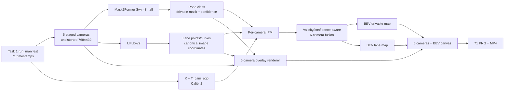

# Task 2 — Implementation Plan: Lane/Drivable Detection và IPM lên BEV

## 1. Mục tiêu

Task 2 xây dựng pipeline task-specific từ ảnh camera để:

1. Phân đoạn **drivable area** bằng **Mask2Former Swin-Small**.
2. Phát hiện **lane line** bằng **Ultra-Fast Lane Detection v2 (UFLD-v2)**.
3. Chiếu kết quả của sáu camera từ image space lên ground plane bằng **Inverse Perspective Mapping (IPM)**.
4. Hợp nhất sáu camera thành hai raster BEV:

```text
M_bev_drivable
M_bev_lane
```

5. Render trực quan toàn bộ 71 keyframe thành PNG và MP4, trong đó mỗi frame phải hiển thị đủ **6 camera + BEV sau IPM**.
6. Tính và hiển thị **metrics/evidence** cho từng kiến trúc và cho output end-to-end; mọi score phải ghi rõ đang dùng human-audited GT hay pseudo-GT/proxy reference.

Pipeline bắt buộc dùng checkpoint:

```text
facebook/mask2former-swin-small-cityscapes-semantic
```

Không được tự động thay bằng Swin-Large đã dùng trong Task 1.

## 2. Khác biệt so với Task 1

| Nội dung | Task 1 — CoMET replacement | Task 2 — Lane/Drivable + IPM |
|---|---|---|
| Mục tiêu | Kiểm tra thông luồng general-purpose annotation → METEOR Factory → train | Tạo trực tiếp lane/drivable map trong image space và BEV |
| Camera | 8 pinhole cameras | 6 camera chuẩn |
| Segmentation model | Mask2Former Swin-Large Mapillary Vistas panoptic | Mask2Former **Swin-Small Cityscapes semantic** |
| Lane model | Không có lane detector image-space riêng | UFLD-v2 |
| 3D | Reference 3D bridge để tạo `sample_annotation` | Không cần CenterPoint hoặc 3D object boxes |
| Output upstream | `surface_ann`, `object_ann`, `sample_annotation` | Drivable masks, lane curves, per-camera IPM và fused BEV |
| Downstream bắt buộc | METEOR Autolabel Factory và train smoke | Renderer 6 camera + BEV; không cần METEOR train để đạt Definition of Done |
| Geometry | T4Dataset/METEOR conversion | Ground-plane homography/IPM trực tiếp |

Task 2 tái sử dụng phần **đồng bộ frame, undistort, resize và calibration** của Task 1, nhưng inference và output được tách riêng. Task 2 không đọc lại panoptic mask Swin-Large của Task 1 làm kết quả chính.

## 3. Input cố định của pilot

### 3.1 Dữ liệu

```text
D:\mentor_data\PNKData\20260301_1443_VF6_01_1772350996_1772351781
```

Calibration bắt buộc:

```text
D:\mentor_data\PNKData_meta_fresh\Calib_2
```

Không dùng thư mục `Calib` cũ.

### 3.2 Frame contract tái sử dụng từ Task 1

Nguồn chính là scene đã được Task 1 chuẩn bị:

```text
out/allroot/pnk_295_1772351165_1772351179/run_manifest.json
out/allroot/pnk_295_1772351165_1772351179/data/<CAMERA>/<timestamp>.jpg
```

Manifest này chứa 71 LiDAR-anchored keyframe ở 5 Hz, đường dẫn ảnh camera đã match, timestamp delta và provenance. Ảnh staged đã:

- undistort;
- resize về `768×432`;
- có intrinsic `K` được cập nhật theo phép biến đổi ảnh;
- sử dụng extrinsic period `2026-02-28_2026-03-19` từ `Calib_2`.

Task 2 phải đọc lại đúng 71 timestamp trong manifest, không chạy một thuật toán frame matching khác. Các file montage trong `out/pnk_e2e/reports/frames` là ảnh trực quan tổng hợp và không phải input inference.

### 3.3 Sáu camera

| Thứ tự | PNK source | Tên trong scene Task 1 |
|---:|---|---|
| 0 | `CAM_P_F` | `CAM_FRONT_WIDE` |
| 1 | `CAM_P_FL` | `CAM_FRONT_LEFT` |
| 2 | `CAM_P_FR` | `CAM_FRONT_RIGHT` |
| 3 | `CAM_P_B` | `CAM_BACK_WIDE` |
| 4 | `CAM_P_LB` | `CAM_BACK_LEFT` |
| 5 | `CAM_P_RB` | `CAM_BACK_RIGHT` |

`CAM_P_L` và `CAM_P_R` không nằm trong scope Task 2. Camera list vẫn phải nằm trong config để có thể thay đổi mà không sửa code.

Quy mô run bắt buộc:

```text
71 timestamps × 6 cameras = 426 camera images
```

## 4. Tech stack và vai trò

| Component | Tech stack | Vai trò | Output |
|---|---|---|---|
| Drivable segmentation | [Mask2Former Swin-Small Cityscapes](https://huggingface.co/facebook/mask2former-swin-small-cityscapes-semantic) | Semantic segmentation trên từng camera; lấy class `road` | Drivable probability/mask trong image space |
| Lane detection | [Ultra-Fast Lane Detection v2](https://github.com/cfzd/Ultra-Fast-Lane-Detection-v2), CULane ResNet-18 baseline | Decode lane anchors thành lane points/curves | Danh sách polyline `(u,v,confidence)` |
| Runtime | PyTorch, Transformers, CUDA | Chạy hai model và cache output | Reproducible per-frame inference |
| Image/calibration | OpenCV, NumPy, Task 1 manifest | Đọc ảnh đã undistort, `K`, `T_cam_ego` | Canonical image and geometry contract |
| IPM | OpenCV `warpPerspective`/`remap` + homography | Chiếu drivable mask và lane points lên ground plane | Per-camera BEV layers + validity mask |
| Multi-camera fusion | NumPy/OpenCV custom fusion | Hợp nhất các vùng nhìn trùng nhau có confidence/validity | Fused lane/drivable BEV |
| Visualization | OpenCV `VideoWriter` | Render 6 camera overlays và BEV, sau đó ghép MP4 | 71 PNG + một MP4 |

UFLD-v2 pretrained trên CULane là baseline flow test. Chất lượng trên camera sau/góc và đường Việt Nam phải được báo cáo trung thực; việc model trả về không có lane là hợp lệ nếu confidence thấp, không được vẽ lane giả để làm đẹp output.

## 5. Output contract

Mỗi timestamp tạo một record:

```text
FrameResult {
  timestamp_ns
  cameras[6] {
    image_path
    drivable_mask          # uint8 [432, 768], {0,1}
    drivable_confidence    # float16/float32 [432, 768]
    lane_polylines[]       # points in canonical 768×432 image coordinates
    lane_confidence[]
    ipm_drivable           # float map [800, 500]
    ipm_lane               # float map [800, 500]
    ipm_valid              # uint8 [800, 500]
  }
  bev_drivable_probability # float map [800, 500]
  bev_drivable_mask        # uint8 [800, 500]
  bev_lane_probability     # float map [800, 500]
  bev_lane_mask            # uint8 [800, 500]
  bev_coverage             # number/weight of contributing cameras
  metrics {
    reference_type         # audit_gt | task1_pseudo_gt | self_consistency
    image_drivable
    image_lane
    ipm_geometry
    fused_bev
    runtime
  }
}
```

Output trên disk:

```text
out/task2_lane_bev/pnk_295_1772351165_1772351179/
├── run_manifest.json
├── config_resolved.yaml
├── cache/
│   ├── mask2former_small/<camera>/<timestamp>.npz
│   └── ufld_v2/<camera>/<timestamp>.json
├── bev/
│   ├── <timestamp>.npz
│   ├── <timestamp>_drivable.png
│   ├── <timestamp>_lane.png
│   └── <timestamp>_coverage.png
├── metrics/
│   ├── frame_metrics.csv
│   ├── camera_summary.csv
│   ├── architecture_scorecard.csv
│   ├── summary.json
│   └── charts/
├── frames/
│   └── 0000_<timestamp>.png
├── evidence/
│   ├── image_space/<camera>/<timestamp>.png
│   ├── bev/<timestamp>.png
│   └── failure_gallery.png
├── task2_6cam_bev.mp4
└── report.json
```

Cache phải atomic và resumable: file chỉ được đổi từ temporary path sang final path sau khi record đã ghi hoàn tất.

## 6. BEV coordinate contract

Để tương thích trực tiếp với BEV của fork METEOR, dùng grid hiện có:

```text
Ego frame:
  X: forward
  Y: left
  Z: up

X ∈ [-80 m, +80 m]
Y ∈ [-50 m, +50 m]
resolution = 0.2 m/cell
shape = [800, 500]
row 0 = far front (+80 m)
col 0 = far left (+50 m)
```

Chỉ các cell có projection hợp lệ mới được fusion. Full grid được giữ để tương thích schema, nhưng báo cáo chất lượng hình học chính tập trung vào near/mid-range ROI:

```text
X ∈ [-20 m, +50 m]
Y ∈ [-20 m, +20 m]
```

## 7. Thiết kế pipeline



### 7.1 Preflight và input adapter

1. Load Task 1 `run_manifest.json`.
2. Chọn đúng sáu camera theo config.
3. Kiểm tra đủ 71 timestamp và 426 ảnh.
4. Kiểm tra ảnh decode được và đúng `768×432`.
5. Đọc `K` và `T_cam_ego` từ T4Dataset calibration/manifest đã tạo ở Task 1.
6. Kiểm tra provenance `Calib_2` và đúng calibration period.
7. Ghi input digest, camera order, timestamp list và calibration ID vào Task 2 manifest.

### 7.2 Drivable area bằng Mask2Former Small

Model ID được pin trong config và report:

```text
facebook/mask2former-swin-small-cityscapes-semantic
```

Các bước:

1. Load `AutoImageProcessor` và `Mask2FormerForUniversalSegmentation`.
2. Chạy inference theo batch phù hợp VRAM, ưu tiên CUDA và tự fallback CPU nếu được cấu hình.
3. Post-process semantic logits về đúng canonical target size `432×768`.
4. Lấy class có `id2label == road`; không hardcode ID nếu checkpoint metadata cung cấp mapping.
5. Xuất:
   - `drivable_probability`;
   - mask nhị phân theo threshold versioned;
   - model revision/checkpoint digest;
   - runtime và shape.
6. Không gộp `sidewalk` vào drivable area trong baseline.

Cityscapes không mô tả toàn bộ quy ước drivable area của PNK. Baseline này định nghĩa drivable là pixel `road`; parking/shoulder hoặc mặt đường bị che có thể thiếu và phải được ghi nhận trong report.

### 7.3 Lane detection bằng UFLD-v2

Baseline dùng UFLD-v2 CULane ResNet-18 để giảm chi phí inference. Input size, row anchors, column anchors và normalization phải lấy từ config UFLD-v2 đã chọn.

Các bước:

1. Resize/normalize từ canonical image theo config của model.
2. Chạy model và decode hybrid row/column anchors.
3. Chuyển lane points từ model-input coordinates về canonical `768×432` coordinates.
4. Loại point ngoài ảnh, dưới confidence threshold hoặc nằm phía trên vùng projection hợp lệ.
5. Sắp xếp points theo curve order, fit/smooth nhẹ nếu đủ point; giữ raw points trong cache để audit.
6. Ghi lane polyline, per-point/per-lane confidence và trạng thái `no_lane_detected`.

UFLD-v2 phải được gọi cho cả sáu camera để đáp ứng deliverable. Quality gate yêu cầu inference record hợp lệ cho mọi camera, nhưng không yêu cầu mọi camera phải có lane ở mọi frame.

### 7.4 IPM và homography

Ảnh đầu vào đã undistort, vì vậy IPM dùng intrinsic sau undistort/resize và không undistort lần hai.

Với ma trận biến đổi từ ego sang camera:

```text
T_cam_ego = [R | t]
```

và ground plane `Z_ego = 0`:

```text
s [u, v, 1]^T = K [r1 r2 t] [X, Y, 1]^T
H_ground_to_image = K [r1 r2 t]
```

Sau đó kết hợp với phép đổi ground coordinate sang BEV pixel để tạo:

```text
H_image_to_bev
H_bev_to_image
```

Implementation phải ghi rõ chiều transform trong tên biến; không dùng tên mơ hồ `extrinsic` hoặc `H` ở boundary API.

#### Drivable projection

- Warp probability map với linear interpolation.
- Warp categorical/binary mask với nearest-neighbor interpolation.
- Warp một all-ones mask để tạo `ipm_valid`.
- Chỉ chấp nhận BEV cell có camera depth dương và image coordinate nằm trong ảnh.
- Loại vùng gần/ở trên horizon nơi inverse homography không ổn định.

#### Lane projection

- Transform từng lane point `(u,v)` bằng `H_image_to_ground`.
- Loại point có denominator gần zero, ngoài BEV hoặc không thuộc valid ground-facing image region.
- Rasterize polyline trong BEV ở độ dày cấu hình theo mét, mặc định khoảng `0.2–0.4 m` để còn nhìn thấy ở resolution `0.2 m/cell`.
- Giữ cả vector points theo mét và raster mask.

### 7.5 Multi-camera fusion

Mỗi camera tạo ba raster: value, confidence và valid coverage.

Baseline fusion:

```text
drivable_probability = weighted_sum(p_i × w_i × valid_i)
                       / sum(w_i × valid_i)

lane_probability = max_i(p_lane_i × w_i × valid_i)
```

Weight ban đầu gồm:

- model confidence;
- khoảng cách từ camera/ego;
- góc nhìn của cell so với optical axis;
- giảm weight gần image border và horizon.

Mọi weight và threshold phải nằm trong config/resolved manifest. Lưu per-camera BEV layers để debug seam, calibration hoặc camera domination. Không morphology mạnh trong baseline; nếu fill hole thì lưu cả raw và post-processed output.

## 8. Thiết kế deliverable trực quan

### 8.1 Kích thước và phân bổ canvas

Canvas ưu tiên `2560×1440`. Có thể xuất bản `1920×1080` bằng cách scale đồng nhất toàn layout, nhưng tỷ lệ phân bổ không được thay đổi:

```text
Left content:  khoảng 65% chiều rộng
Right BEV:     khoảng 35% chiều rộng, chạy trọn 100% chiều cao
```

Ở canvas `2560×1440`:

```text
Six-camera/metrics region: x=[0,1660),    y=[0,1440)
Fused BEV region:          x=[1660,2560), y=[0,1440)  → 900×1440
```

BEV gốc có shape `800×500` theo thứ tự height×width. Khung `900×1440` giữ đúng aspect ratio `500:800`, vì vậy BEV được phóng lớn trọn chiều cao mà không bị kéo méo hoặc crop.

### 8.2 Layout bắt buộc

Sáu camera nằm bên trái theo lưới `3×2`. **Fused BEV chiếm toàn bộ cột bên phải**, đặt ngay bên phải hai panel `FRONT RIGHT` và `BACK RIGHT`:

```text
┌─────────────────┬─────────────────┬─────────────────┬──────────────────────────┐
│ FRONT           │ FRONT LEFT      │ FRONT RIGHT     │                          │
│ drive + lane    │ drive + lane    │ drive + lane    │                          │
│ camera metrics  │ camera metrics  │ camera metrics  │                          │
├─────────────────┼─────────────────┼─────────────────┤                          │
│ BACK            │ BACK LEFT       │ BACK RIGHT      │     FUSED BEV LARGE      │
│ drive + lane    │ drive + lane    │ drive + lane    │                          │
│ camera metrics  │ camera metrics  │ camera metrics  │  drivable + lane + ego  │
├─────────────────┴─────────────────┴─────────────────┤  coverage + distance     │
│ METRICS / EVIDENCE DASHBOARD                       │  current BEV metrics     │
│ AUDIT · PROXY · SELF · running aggregate · runtime │                          │
│ charts / warning / timestamp / model provenance    │                          │
└─────────────────────────────────────────────────────┴──────────────────────────┘
```

Các ràng buộc layout:

1. Cột BEV không được chia sẻ với camera, chart hoặc log text.
2. BEV phải bắt đầu từ mép trên và kết thúc ở mép dưới canvas.
3. `FRONT RIGHT` và `BACK RIGHT` phải tiếp giáp trực tiếp với cạnh trái của BEV.
4. Metrics dashboard nằm dưới lưới sáu camera, không đặt dưới BEV.
5. Không thu nhỏ BEV để thêm legend; legend dùng overlay nhỏ ở vùng trống hoặc nằm trong dashboard bên trái.
6. Tất cả frame dùng cùng pixel rectangles để video không rung layout.

### 8.3 Nội dung panel sáu camera

Mỗi camera cell có ba vùng:

1. Header: camera name, timestamp và trạng thái inference.
2. Image: ảnh `768×432` giữ aspect ratio, overlay drivable/lane.
3. Footer: metrics ngắn của camera hiện tại.

Overlay bắt buộc:

- drivable prediction: xanh lá trong suốt;
- lane curve: cyan/vàng, giữ nhìn thấy ảnh gốc;
- TP/FP/FN khi có reference: xanh lá/đỏ/xanh dương;
- `NO LANE` khi UFLD trả về prediction rỗng hợp lệ;
- warning badge nếu confidence thấp, thiếu reference hoặc camera không có valid IPM coverage.

Footer camera chỉ hiển thị metric ngắn để không che ảnh:

```text
Drive IoU 0.xxx [AUDIT|PROXY] · Lane F1 0.xxx · xx.x ms
```

Metric không có reference phải ghi `N/A`, không thay bằng `0`.

### 8.4 Nội dung Fused BEV lớn bên phải

BEV panel hiển thị theo đúng coordinate convention:

- phía trên: `+X`, hướng tiến của xe;
- phía trái ảnh BEV: `+Y`, phía trái ego;
- ego footprint và heading marker ở đúng tọa độ;
- grid lines và distance labels theo mét;
- fused drivable probability/mask;
- fused lane curves/mask;
- invalid/unobserved cells màu đen;
- coverage thấp được hatch hoặc giảm alpha;
- optional per-camera contribution color chỉ bật trong debug render.

BEV metric badge được đặt gọn ở mép trên hoặc góc không che ego/road:

```text
Drive IoU/Dice [AUDIT|PROXY]
Lane F1 · Chamfer (m)
Coverage · IPM p95
```

Fused BEV phải là layer trực quan lớn nhất trong frame. Renderer không được dùng ảnh thumbnail BEV rồi upscale bằng nearest-neighbor; phải render trực tiếp từ raster `800×500` lên output resolution với interpolation phù hợp: nearest cho categorical mask, linear cho probability/heatmap và antialias cho vector lane/grid.

### 8.5 Metrics/evidence dashboard bên trái phía dưới

Dashboard sử dụng toàn bộ vùng còn lại dưới sáu camera và gồm:

- reference type nổi bật: `AUDIT`, `PROXY` hoặc `SELF`;
- current-frame và running mean của road IoU/Dice;
- current-frame và running mean của lane F1/Chamfer;
- IPM round-trip p95, overlap consistency và valid coverage;
- latency Mask2Former, UFLD, IPM/fusion và end-to-end;
- model/checkpoint IDs dạng rút gọn;
- timestamp/frame index;
- warning/failure reason;
- sparkline hoặc bar nhỏ theo camera nếu còn không gian.

Dashboard không được lặp lại toàn bộ BEV hoặc làm BEV nhỏ đi. Evidence chi tiết TP/FP/FN được lưu thành file riêng; video chỉ hiển thị overlay và summary đủ để reviewer hiểu score.

### 8.6 Quy ước màu

- drivable overlay image: xanh lá trong suốt;
- lane curve image: cyan/vàng;
- BEV drivable: xám hoặc xanh lá tối;
- BEV lane: vàng/trắng;
- ego footprint: xanh dương;
- heading/trục: đỏ;
- invalid/unobserved BEV: đen;
- TP/FP/FN: xanh lá/đỏ/xanh dương;
- low coverage hoặc uncertainty: cam;
- per-camera contributions: palette riêng trong debug mode.

Màu phải nhất quán giữa camera overlay, BEV, legend, evidence images và toàn bộ video.

### 8.7 Deliverable bắt buộc

1. 71 PNG, mỗi PNG có đủ sáu camera bên trái và Fused BEV lớn chạy trọn chiều cao bên phải.
2. MP4 chứa đúng 71 frame, mặc định 5 FPS, layout cố định.
3. 71 ảnh BEV riêng ở native/full visualization resolution để review mà không phụ thuộc composite canvas.
4. Một ảnh debug geometry riêng cho mỗi camera ở frame đầu, gồm projected ground grid/horizon.
5. Dashboard trong từng composite frame hiển thị current-frame metrics, running aggregate và loại reference.
6. Evidence overlays thể hiện TP/FP/FN cho image-space và BEV trên các frame có reference.
7. `metrics/summary.json`, CSV và charts so sánh Mask2Former Small, UFLD-v2, IPM và fused BEV.
8. `report.json` tổng hợp coverage, empty predictions, accuracy/proxy metrics, runtime và validation gates.

### 8.8 Renderer gates

Renderer phải fail nếu:

- thiếu bất kỳ camera panel nào trong sáu camera;
- `FRONT RIGHT`/`BACK RIGHT` không tiếp giáp cột BEV;
- BEV không chiếm trọn chiều cao cột phải;
- BEV bị crop, kéo sai aspect ratio hoặc nhỏ hơn kích thước tối thiểu theo layout;
- thiếu metrics dashboard;
- sai frame count;
- fused BEV hoàn toàn rỗng trong valid ROI;
- score không ghi reference type.

Nếu frame không có audit GT, dashboard phải ghi `PROXY`, `SELF` hoặc `N/A — NO REFERENCE`; không được hiển thị proxy score dưới nhãn `accuracy`.

## 9. Cấu trúc code dự kiến

Tạo package riêng để giữ Task 2 độc lập với runner CoMET replacement, nhưng tái sử dụng Task 1 manifest contract:

```text
pnk_lane_bev/
├── pyproject.toml
├── README.md
├── run_task2.ps1
└── src/pnk_lane_bev/
    ├── __init__.py
    ├── cli.py
    ├── config.py
    ├── task1_input.py
    ├── mask2former_small.py
    ├── ufld_v2.py
    ├── geometry.py
    ├── ipm.py
    ├── fusion.py
    ├── metrics.py
    ├── evidence.py
    ├── renderer.py
    ├── validator.py
    └── report.py
```

CLI dự kiến:

```powershell
pnk-lane-bev preflight --task1-scene <scene-dir> --out <report>
pnk-lane-bev infer-drivable --task1-scene <scene-dir> --cache <dir>
pnk-lane-bev infer-lane --task1-scene <scene-dir> --cache <dir>
pnk-lane-bev project-bev --task1-scene <scene-dir> --cache <dir> --out <dir>
pnk-lane-bev evaluate --root <task2-output> --references <reference-config>
pnk-lane-bev validate --root <task2-output> --report <report>
pnk-lane-bev render --root <task2-output> --frames-dir <dir> --video <file>
```

Wrapper toàn luồng:

```powershell
.\pnk_lane_bev\run_task2.ps1
```

## 10. Phases triển khai

### Phase 0 — Data và geometry contract

1. Đọc Task 1 manifest và chốt sáu camera.
2. Xác nhận ảnh `768×432`, camera order và calibration period.
3. Chốt BEV grid `800×500 @ 0.2 m`.
4. Render projected ground grid trên sáu ảnh của một timestamp.
5. Sửa mọi lỗi transform direction/K resize trước khi chạy model.

**Gate:** ground grid nằm trên bề mặt đường quan sát được, trục trái/phải và trước/sau đúng trên cả camera trước lẫn sau.

### Phase 1 — Single-frame model adapters

1. Chạy Mask2Former Small trên sáu ảnh của frame đầu.
2. Chạy UFLD-v2 trên sáu ảnh của frame đầu.
3. Render overlay image-space và ghi raw cache.
4. Xác nhận mapping lane points trở lại `768×432`.

**Gate:** đủ sáu inference records; Mask2Former model ID đúng bản Small; không có shape mismatch; lane points không vượt ảnh.

### Phase 2 — IPM per camera

1. Precompute homography/remap table cho từng camera.
2. Warp drivable probability/mask.
3. Transform và rasterize lane curves.
4. Lưu per-camera BEV và valid coverage.
5. Kiểm tra image → ground → image round-trip.

**Gate:** round-trip median dưới 1 pixel trên các điểm hợp lệ; không có NaN/Inf; camera trước và sau chiếu đúng nửa không gian tương ứng.

### Phase 3 — Six-camera fusion

1. Áp dụng validity/confidence weights.
2. Tạo fused drivable/lane maps và coverage raster.
3. Render seam/overlap debug.
4. Chốt threshold baseline từ một tập frame nhỏ đại diện.

**Gate:** fused BEV không rỗng trong near/mid-range ROI; không có một camera chiếm toàn bộ vùng ngoài FOV của nó; unobserved cells giữ invalid.

### Phase 4 — Full-folder run

1. Chạy 426 ảnh với cache/resume.
2. Tạo 71 BEV records.
3. Chạy validator.
4. Render 71 PNG và MP4.
5. Ghi report/provenance.

**Gate:** không thiếu timestamp, camera, cache, BEV array hoặc visual frame.

### Phase 5 — Metrics, evidence và quality review

1. Review các frame thẳng, cua, đông xe, bị che và camera sau.
2. Báo tỷ lệ empty/low-confidence của UFLD theo từng camera.
3. Báo drivable coverage theo camera và khoảng cách.
4. Tính full-folder proxy metrics với road/lane pseudo-label của Task 1 và output METEOR Factory; mọi bảng/ảnh/video ghi rõ `PSEUDO-GT/PROXY`.
5. Nếu có audit GT, tính accuracy metrics riêng trên audit split và không trộn với proxy metrics.
6. Sinh architecture scorecard, charts và worst-case failure gallery.
7. Chỉ fine-tune hoặc thêm temporal smoothing sau khi baseline geometry đã qua gate.

## 11. Validation và acceptance criteria

### Input gates

- `71/71` timestamp được load.
- `426/426` ảnh sáu camera tồn tại và decode được.
- Mọi ảnh canonical có shape `432×768`.
- Timestamp/camera order giống Task 1 manifest.
- Calibration provenance là `Calib_2`, đúng period.

### Model gates

- `426/426` Mask2Former records được tạo bằng exact Small model ID.
- `426/426` UFLD records tồn tại, kể cả record hợp lệ với `no_lane_detected=true`.
- Mọi mask/point được map về canonical image coordinates.
- Không có NaN/Inf trong confidence hoặc logits đã lưu.

### Geometry gates

- Homography khả nghịch và không suy biến cho cả sáu camera.
- Projection chỉ sử dụng point có positive camera depth.
- Image↔ground round-trip median `< 1 px`, p95 `< 2 px` trên synthetic valid points.
- BEV arrays đúng `[800,500]`, đúng row/column convention của METEOR.
- Có `coverage` riêng; invalid cells không bị gán drivable/lane.

### Metrics/evidence gates

- Có metric record cho `426/426` camera images và `71/71` fused BEV frames.
- Mỗi metric record có `reference_type`, `reference_id/version` và `sample_count`.
- Audit GT, Task 1 pseudo-GT và self-consistency được aggregate thành các bảng riêng.
- Drivable metrics gồm tối thiểu IoU, Dice, precision và recall khi có reference.
- Lane metrics gồm tối thiểu lane F1 và point/polyline error khi có reference.
- IPM metrics gồm round-trip error, valid coverage và cross-camera consistency.
- Runtime gồm median/p95 latency và peak VRAM cho từng model/stage.
- Worst-case evidence dùng đúng prediction/reference đã tạo metric, không render từ output khác.

### Deliverable gates

- `71/71` fused BEV records.
- `71/71` PNG có đủ 6 camera panels và một BEV panel.
- MP4 có 71 frame, đọc lại được, resolution/layout cố định.
- Drivable và lane đều xuất hiện trong legend và BEV layer; nếu lane detector không tìm thấy lane ở một frame/camera, panel phải hiển thị trạng thái rõ ràng.
- Metrics panel luôn hiển thị loại reference; audit GT, pseudo-GT và self-consistency không bị gộp thành một score.
- Evidence overlays TP/FP/FN tồn tại cho mọi frame có reference.
- CSV/JSON metrics không có NaN/Inf không giải thích; metric không áp dụng phải ghi `null` kèm reason.
- `report.json` ghi model revision/checkpoint hash, config, calibration ID, timestamp coverage, metrics, runtime và mọi warning.

## 12. Evaluation contract: metrics và evidence

### 12.1 Ba mức reference

Để tránh gọi agreement với một model khác là độ chính xác tuyệt đối, evaluator tách ba nguồn reference:

| Mức | Reference | Phạm vi | Cách diễn giải |
|---|---|---|---|
| **A — Audit GT** | Mask/polylines/BEV được con người review | Tập nhỏ, chọn có chủ đích | Có thể dùng để báo accuracy |
| **B — Task 1 pseudo-GT** | Mask2Former Swin-Large panoptic, `seg2d21`, BEV lane/road do METEOR Factory sinh | Toàn bộ 71 frame nếu artifact tồn tại | Chỉ báo agreement/proxy metric |
| **C — Self-consistency** | Cross-camera overlap, LiDAR ground support, round-trip và temporal warp | Toàn bộ 71 frame | Bằng chứng geometry/stability, không phải semantic accuracy |

Audit set đề xuất gồm tối thiểu `12 timestamps × 6 cameras = 72 images`, stratified theo:

- đường thẳng;
- đường cong;
- giao lộ;
- mật độ xe cao/che khuất;
- camera sau và camera góc;
- near/mid/far visibility.

Mỗi audit image có binary drivable mask và lane polylines. Mỗi audit timestamp có BEV lane/drivable reference được review trên ảnh sáu camera kết hợp LiDAR/map view. Nếu audit set chưa có, run vẫn tạo đầy đủ proxy/self-consistency evidence nhưng trạng thái phải là:

```text
PASS_PROXY_ONLY
```

Chỉ khi có audit GT hợp lệ mới dùng trạng thái:

```text
PASS_WITH_AUDIT_GT
```

### 12.2 Mask2Former Small — image-space drivable metrics

Tính trên valid reference pixels, theo từng camera và aggregate macro-average:

```text
IoU_road   = TP / (TP + FP + FN)
Dice/F1    = 2TP / (2TP + FP + FN)
Precision  = TP / (TP + FP)
Recall     = TP / (TP + FN)
```

Metrics bổ sung:

- **Boundary F1** với tolerance cấu hình theo pixel để đo chất lượng mép đường;
- **Brier score** và **Expected Calibration Error (ECE)** cho probability/confidence;
- empty-mask rate và predicted drivable coverage;
- breakdown theo camera và projected distance bins.

Evidence image hiển thị:

- true positive: xanh lá;
- false positive: đỏ;
- false negative: xanh dương;
- boundary mismatch: vàng;
- score và loại reference ngay trên panel.

### 12.3 UFLD-v2 — image-space lane metrics

Lane prediction và reference được rasterize với cùng line width trước khi matching. Dùng Hungarian matching giữa predicted/reference polylines.


Metrics chính:

- **Lane precision, recall và F1** với match rule theo line-IoU threshold;
- **Lane F1@IoU 0.5** theo cách gần với CULane-style evaluation;
- mean và p95 point-to-polyline distance trong pixel;
- false-positive lanes/frame;
- missed lanes/frame;
- no-lane/empty prediction rate theo camera.

Sau IPM, báo thêm lateral/Chamfer error theo mét:

```text
d_chamfer(P,G) = 0.5 × mean_p min_g ||p-g||
               + 0.5 × mean_g min_p ||g-p||
```

Breakdown khoảng cách:

```text
near: 0–20 m
mid:  20–40 m
far:  40–60 m
```

### 12.4 IPM/calibration metrics

Các metric này đo implementation và consistency của geometry:

- image → ground → image round-trip error: median/p95 pixel;
- ground → image → ground round-trip error: median/p95 mét;
- homography condition number và invalid projection rate;
- BEV valid coverage ratio theo camera và distance bin;
- cross-camera drivable overlap IoU trong vùng hai camera cùng nhìn thấy;
- cross-camera lane seam Chamfer distance theo mét;
- LiDAR-ground support recall: tỷ lệ ground-candidate points nằm trong predicted drivable BEV;
- non-ground leakage proxy: tỷ lệ obstacle/non-ground candidates rơi vào vùng drivable.

Round-trip error chỉ chứng minh phép biến đổi số học nhất quán. Cross-camera overlap và LiDAR support mới cung cấp thêm evidence về calibration/ground-plane assumption; các metric này vẫn là self-consistency, không thay audit GT.

### 12.5 Fused BEV metrics

Nếu có BEV reference, tính trong valid-overlap ROI:

#### Drivable BEV

- IoU, Dice/F1, precision và recall;
- boundary F1 theo tolerance mét;
- false-drivable area và missed-drivable area tính bằng `m²`;
- metric theo near/mid/far bins và trước/sau ego.

#### Lane BEV

- raster lane IoU và F1;
- centerline Chamfer distance, mean/p95 mét;
- lateral offset error tại các longitudinal anchors;
- topology evidence: số component, broken-lane gap length và spurious branch count.

#### Temporal stability

Dùng NAV ego motion warp output frame `t` sang `t+1`, sau đó báo:

- warped drivable IoU;
- warped lane Chamfer;
- frame-to-frame flicker ratio trong vùng cùng quan sát.

Temporal metric đo độ ổn định, không tự động được gọi là accuracy.

### 12.6 Architecture scorecard

`architecture_scorecard.csv` và dashboard tổng hợp:

| Architecture/stage | Primary quality metric | Secondary evidence | Runtime evidence |
|---|---|---|---|
| Mask2Former Swin-Small | Road IoU/Dice | Boundary F1, ECE, Task 1 Large agreement | median/p95 ms, peak VRAM |
| UFLD-v2 ResNet-18 | Lane F1 | Chamfer/lateral error, empty rate | median/p95 ms, peak VRAM |
| IPM per camera | Round-trip error | overlap IoU, seam error, valid coverage | ms/camera |
| Six-camera fusion | BEV IoU/Lane Chamfer | distance bins, temporal stability | median/p95 ms |
| End-to-end | Audit/proxy BEV score | failure rate and coverage | FPS, total latency |

Mask2Former Swin-Large của Task 1 chỉ đóng vai trò teacher/reference proxy. Scoreboard không được kết luận Small chính xác hơn/kém hơn Large nếu chưa có cùng audit GT.

### 12.7 Metrics hiển thị trong PNG/MP4

Mỗi camera panel hiển thị tối đa các thông tin ngắn:

```text
Drive IoU: 0.xxx [AUDIT|PROXY]
Lane F1:   0.xxx [AUDIT|PROXY]
Conf:      0.xxx
Latency:   xx.x ms
```

BEV/dashboard hiển thị:

```text
BEV drive IoU / Dice
BEV lane Chamfer (m)
IPM round-trip p95
valid coverage
current frame + running mean
reference type
```

Nếu metric không có reference, hiển thị `N/A — NO REFERENCE` thay vì `0`. Video phải dùng màu hoặc badge khác nhau cho `AUDIT`, `PROXY` và `SELF`.

### 12.8 Evidence artifacts

Ngoài video, deliverable gồm:

1. `frame_metrics.csv`: metric từng timestamp/camera.
2. `camera_summary.csv`: mean, median, p95 và sample count theo camera.
3. `architecture_scorecard.csv`: quality/cost của từng stage.
4. Charts theo camera, distance bin và thời gian.
5. PR/threshold curve cho drivable và lane khi probability/reference cho phép.
6. Top-K best/worst frames theo từng metric.
7. Failure gallery kèm nguyên nhân: domain, occlusion, calibration, horizon, no-lane hoặc seam.
8. TP/FP/FN overlays để người review có thể kiểm chứng số liệu bằng hình ảnh.

Accuracy threshold chưa được dùng để loại baseline đầu tiên trước khi có audit GT. Run đầu tiên thiết lập baseline và frozen evaluation config; các run sau phải dùng cùng reference/config để regression gate có ý nghĩa.

## 13. Rủi ro và cách xử lý

| Rủi ro | Ảnh hưởng | Xử lý |
|---|---|---|
| Mask2Former Cityscapes khác domain Hà Nội | Road mask thiếu hoặc nhầm ở giao lộ, vùng vá đường, parking | Giữ confidence, review theo camera; chuẩn bị fine-tune sau baseline |
| UFLD-v2 pretrained chủ yếu cho front-view datasets | Camera góc/sau có thể ít lane hoặc sai curve | Báo per-camera confidence/empty rate; không ép lane; fine-tune PNK nếu cần |
| Flat ground `Z=0` | IPM méo trên dốc, gờ hoặc mặt đường không phẳng | Validity/distance gating; optional IMU pitch/roll compensation ở phase sau |
| Dùng sai chiều extrinsic | BEV lật trước/sau hoặc trái/phải | Projected ground-grid gate và round-trip test trước inference full folder |
| Dùng K gốc với ảnh đã resize/undistort | Tất cả layer bị lệch | Chỉ đọc K đã cập nhật từ Task 1 scene/calibration records |
| Double undistort | Hình và K không còn khớp | Task 2 coi staged image là canonical và không undistort lại |
| Overlap/seam giữa camera | BEV có vệt đứt hoặc camera domination | Lưu per-camera layers, coverage, angle/border weights |
| Object che khuất road | Drivable mask tạo hole | Giữ raw output; chỉ dùng postprocess nhỏ và có version, không fill mù |
| Checkpoint/license khác source-code license | Không thể phân phối lại model | Ghi rõ model/checkpoint provenance và review license trước khi publish |
| Dùng pseudo-GT như human GT | Score có vẻ chính xác nhưng chỉ đo model agreement | Tách `AUDIT`, `PROXY`, `SELF`; ghi reference type trên mọi artifact |
| Chọn threshold theo chính audit/test set | Metrics bị optimistic | Freeze threshold trên calibration subset, báo metric trên audit subset tách biệt |

## 14. Definition of Done

Task 2 hoàn thành khi một lệnh tạo được toàn bộ artifacts sau từ scene Task 1:

```text
Task 1 synchronized six-camera frames
  → Mask2Former Swin-Small drivable masks
  → UFLD-v2 lane curves
  → calibrated six-camera IPM
  → fused drivable/lane BEV
  → metrics + TP/FP/FN evidence
  → 71 visual frames
  → task2_6cam_bev.mp4
```

Kết quả phải có segmentation drivable, lane detection, BEV sau IPM và metrics/evidence có provenance. Chỉ render sáu ảnh camera mà không có fused BEV, chỉ có BEV mà không hiển thị đủ sáu camera, hoặc hiển thị score không ghi loại reference đều không đạt yêu cầu deliverable.

## 15. Tài liệu tham khảo

- [Task 2 overview](overview.md)
- [CLRNet/UFLD result report và checklog 40–70 m](REPORT_RESULT.md)
- [Mask2Former Swin-Small Cityscapes](https://huggingface.co/facebook/mask2former-swin-small-cityscapes-semantic)
- [Ultra-Fast Lane Detection v2](https://github.com/cfzd/Ultra-Fast-Lane-Detection-v2)
- [OpenCV geometric image transformations](https://docs.opencv.org/4.x/da/d54/group__imgproc__transform.html)
- [Dataset overview](../DATASET_OVERVIEW.md)
- [Task 1 CoMET replacement plan](../COMET_REPLACEMENT/COMET_REPLACEMENT_IMPLEMENTATION_PLAN.md)

## 16. Lane branch v2 — implementation và kết quả thực chạy

### 16.1 Phạm vi đã implement

Code mới nằm trong `pnk_lane_bev/src/pnk_lane_bev/`:

| Module | Vai trò |
|---|---|
| `lane_types.py` | Interface `LaneDetector`, `LanePrediction`, `LaneCurve` dùng chung |
| `lane_preprocess.py` | Đọc raw camera, Calib_2 intrinsic/distortion, undistort, canonical resize và ROI |
| `ufld_v2.py` | `UFLDDetector` baseline qua interface chung |
| `clrnet.py` | `CLRNetDetector` dùng checkpoint CULane ResNet-18 chính thức; NMS PyTorch thay extension CUDA cũ |
| `lane_pipeline.py` | Inference, confidence filtering, IPM, contribution map và weighted fusion |
| `lane_evaluation.py` | Benchmark detector, breakdown sáu camera, Before/After và bottleneck evidence |
| `lane_renderer.py` | Video 2560×1440 gồm 6 camera, fused BEV lớn và 6 contribution maps |
| `lane_validation.py` | Count/schema/video validation và kiểm tra drivable non-regression |
| `lane_finetune.py` | Validator/manifest adapter cho target-domain lane annotations |

Preprocessing thực tế:

```text
raw source_path từ Allroot manifest
  → cv2.undistort(K, distortion từ Calib_2)
  → resize 768×432 canonical
  → ROI normalized theo camera config
  → detector-specific resize/normalization
  → map lane point từ ROI về canonical image
```

ROI, threshold, enable flag và reliability weight của cả sáu camera nằm trong:

```text
pnk_lane_bev/configs/lane/cameras/pnk_6cam.yaml
```

Không có ROI hoặc checkpoint cố định bên trong detector call site.

### 16.2 Fusion contract

Prediction rỗng hoặc không đạt camera threshold không đi vào IPM/fusion. Với camera hợp lệ:

\[
w_c(x,y)=p_c\,q_c\,d_c(x,y)\,e_c(x,y)
\]

Trong đó `p_c` là camera prior, `q_c` là mean prediction confidence, `d_c` là distance reliability và `e_c` là valid/edge reliability. Fused confidence:

\[
M_{BEV}(x,y)=
\frac{\sum_c w_c(x,y)M_c(x,y)}
     {\sum_c w_c(x,y)}
\]

Mẫu số chỉ gồm camera có lane support tại cell đang xét. NPZ lưu `per_camera_fusion_weight`, `per_camera_contribution` và `per_camera_contribution_share` để debug.

Camera prior sau baseline evidence:

```yaml
CAM_FRONT_WIDE:  0.75
CAM_FRONT_LEFT:  0.00
CAM_FRONT_RIGHT: 0.00
CAM_BACK_WIDE:   1.00
CAM_BACK_LEFT:   0.15
CAM_BACK_RIGHT:  0.00
```

Ablation `CAM_BACK_LEFT=0` làm UFLD BEV Chamfer tăng từ `15.914 m` lên `15.997 m`, nên giữ contribution nhỏ `0.15`.

### 16.3 Benchmark full folder

Đã chạy đủ `71 frame × 6 camera = 426 ảnh` cho cả hai detector, cùng preprocessing, reference và evaluator.

| Pipeline | Lane F1 | Empty rate | Lane/frame | Mean runtime/image | Fused BEV Chamfer |
|---|---:|---:|---:|---:|---:|
| Before — legacy UFLD/max fusion | 0.0997 | 78.17% | 0.523 | 27.46 ms | 15.216 m |
| After — UFLD-v2/weighted fusion | 0.0985 | 78.40% | 0.528 | 42.29 ms | 15.914 m |
| CLRNet candidate | 0.0876 | 86.15% | 0.364 | 35.55 ms | 18.571 m |

Per-camera Lane F1:

| Camera | Before | UFLD-v2 v2 | CLRNet |
|---|---:|---:|---:|
| FRONT_WIDE | 0.1312 | 0.1360 | 0.1274 |
| FRONT_LEFT | 0.0000 | 0.0000 | 0.0000 |
| FRONT_RIGHT | 0.0000 | 0.0000 | 0.0000 |
| BACK_WIDE | 0.4482 | 0.4389 | 0.3982 |
| BACK_LEFT | 0.0185 | 0.0161 | 0.0000 |
| BACK_RIGHT | 0.0000 | 0.0000 | 0.0000 |

Tất cả số trên là **PROXY_TASK1 agreement**, không phải human-audited accuracy.

### 16.4 Kết luận bottleneck

- **Detector bottleneck: có.** Best Lane F1 vẫn chỉ `0.0985` và empty rate `78.4%`; bốn camera góc gần như không tạo lane.
- **IPM bottleneck: chưa thể kết luận là bottleneck tiếp theo.** Image-space lane chưa đủ mạnh để tách riêng lỗi detector và lỗi projection.
- **Calibration bottleneck: chưa được cô lập bởi proxy hiện tại.** Round-trip implementation vẫn pass, nhưng cần lane audit GT/cross-camera landmark để kết luận extrinsic accuracy.
- **Fusion bottleneck: có evidence thứ cấp.** Fused Chamfer `15.914 m` lớn hơn mean Chamfer trên các camera có prediction, nhưng kết quả vẫn bị giới hạn trước hết bởi sparse/empty input.
- **CLRNet không tốt hơn mặc định.** Trên target folder này CLRNet có F1 thấp hơn và empty rate cao hơn UFLD-v2.

Vì `Lane F1` không tăng và `EmptyRate` không giảm, phase tiếp theo nên chuẩn bị human-reviewed target lane labels và fine-tune/domain adaptation. Chưa có cơ sở để triển khai Mamba/GenMapping, learned IPM, OSM prior hoặc temporal neural refinement.

### 16.5 Acceptance evidence

- `426/426` cache record cho UFLD-v2 và `426/426` cho CLRNet.
- `71/71` fused BEV record cho mỗi detector.
- `426/426` raw/undistorted/ROI visualization.
- Hai MP4 đọc lại được, mỗi video `71 frame`, `2560×1440`, `5 FPS`.
- Drivable arrays khớp bit-for-bit với baseline ở `142/142` detector-frame records.
- Validation status: `PASS_PROXY_ONLY`.

Report máy đọc được:

```text
out/task2_lane_bev/pnk_295_1772351165_1772351179/lane_v2/report.json
```

## 17. Unified Mask2Former branch — không dùng UFLD-v2

### 17.1 Mục tiêu và inference contract

Nhánh mới dùng đúng một checkpoint `facebook/mask2former-swin-large-mapillary-vistas-panoptic` cho cả drivable area và lane marking:

```text
Six-camera RGB
  → Mask2Former panoptic/semantic
  → configurable class filtering
      ├── drivable mask
      └── lane mask
  → lane confidence + morphology + component filtering
  → calibrated IPM cho cả hai mask
  → confidence-weighted six-camera fusion
  → fused drivable/lane BEV
```

CLI `pnk_lane_bev.unified_cli` là inference path độc lập. `UFLD-v2` và `CLRNet` chỉ còn trong baseline artifacts để so sánh, không được import hoặc gọi bởi CLI mới.

### 17.2 Taxonomy và cấu hình

Config nằm tại:

```text
pnk_lane_bev/configs/segmentation/mapillary_swin_large.yaml
```

Class được resolve theo `model.config.id2label`, case-insensitive và fail fast nếu checkpoint không có tên cấu hình.

```yaml
drivable_classes:
  - Road
  - Service Lane
  - Bike Lane
  - Parking
  - Crosswalk - Plain
  - Lane Marking - General
  - Lane Marking - Crosswalk

lane_classes:
  - Lane Marking - General
  - Lane Marking - Crosswalk
```

Mỗi camera có `enabled`, `reliability_weight` và `lane_confidence_threshold`. Lane post-processing có `close_kernel`, `open_kernel`, `min_component_pixels` và `skeletonize`; skeletonization mặc định tắt để giữ đủ support cho metric mask.

### 17.3 Module đã implement

| Module | Vai trò |
|---|---|
| `mask2former_unified.py` | `Mask2FormerDetector.predict(RGB)`, semantic/panoptic, class filter và lane post-processing |
| `unified_config.py` | validate config và resolve taxonomy |
| `unified_bev.py` | project drivable/lane sang BEV, lưu per-camera layers và weighted fusion |
| `unified_evaluation.py` | image/BEV metrics, breakdown sáu camera và baseline comparison |
| `unified_renderer.py` | artifact cho từng camera và video 6 camera + fused BEV lớn bên phải |
| `unified_validation.py` | kiểm tra schema, count, artifacts, video và UFLD absence |
| `unified_cli.py` | `prepare → infer → benchmark → project → evaluate → render → validate` |

Fusion dùng:

\[
w_c(x,y)=p_c\,q_c(x,y)\,d_c(x,y)\,e_c(x,y)
\]

\[
M_{BEV}(x,y)=
\frac{\sum_c w_c(x,y)M_c(x,y)}
     {\sum_c w_c(x,y)}
\]

Trong đó `p_c` là camera prior, `q_c` là semantic confidence, `d_c` là distance reliability và `e_c` là valid/edge support. Camera weight bằng 0 bị loại khỏi fusion nhưng prediction vẫn có thể được lưu để debug.

### 17.4 Full-folder result và acceptance

Đã chạy `71 frame × 6 camera = 426 ảnh`:

| Check | Kết quả |
|---|---:|
| Mask2Former unified predictions | 426/426 |
| Fused BEV records | 71/71 |
| Per-camera artifact sets | 426/426 |
| Fused BEV PNG | 71/71 |
| Rendered video frames | 71/71 |
| Validation failures | 0 |
| Status | `PASS_PROXY_ONLY` |

| Pipeline | Lane F1 | Empty rate | BEV Lane F1 | BEV Chamfer |
|---|---:|---:|---:|---:|
| Legacy UFLD-v2 | 0.0997 | 78.17% | N/A | 15.216 m |
| Unified Mask2Former | 0.8710 | 8.69% | 0.3685 | 7.578 m |

Image reference `seg2d21` được tạo từ cùng upstream Mask2Former checkpoint. Vì vậy Lane F1/Drivable IoU ở image space là **source-coupled consistency**, không phải human-audited accuracy. Mức giảm empty rate vẫn là evidence hữu ích rằng sáu camera nay có lane support để tiếp tục audit IPM.

Khoảng cách từ image Lane F1 `0.8710` xuống BEV Lane F1 `0.3685`, cùng fused Chamfer `7.578 m` cao hơn mean available per-camera Chamfer `5.352 m`, cho thấy bottleneck thực dụng đã chuyển sang IPM/ground-plane và fusion. Calibration vật lý chưa được cô lập bởi proxy hiện tại.

### 17.5 Deliverable

```text
out/task2_lane_bev/pnk_295_1772351165_1772351179/mask2former_unified/
├── cache/mask2former_unified/
├── bev/
├── bev_visual/per_camera/
├── artifacts/per_camera/
├── artifacts/fused_bev/
├── metrics/
├── validation_report.json
└── deliverables/task2_mask2former_unified_6cam_bev.mp4
```
